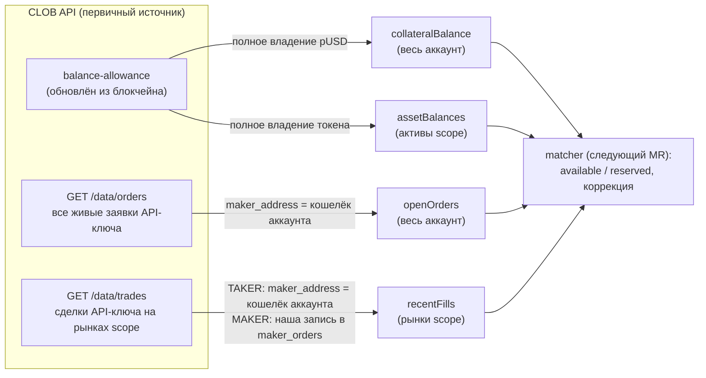
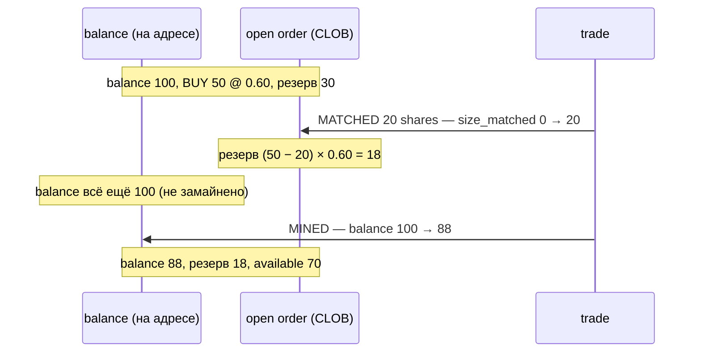

# Polymarket CLOB: семантика балансов и контракт сверки

Что означают балансы, которые `PolymarketAccountVenueStateSource` получает
от CLOB API, и какие выводы из них вправе делать будущий matcher сверки.

**Архитектурное решение:** первичный источник состояния аккаунта — CLOB API
Polymarket. Polygon RPC и независимой on-chain проверки баланса на этом этапе
нет.

## Проблема

Matcher приведёт локальный `Portfolio` к состоянию площадки:

```text
Portfolio.balance.available + Portfolio.balance.reserved = authoritative collateral total
Position.quantity = TokenBalance.available + TokenBalance.reserved = authoritative outcome inventory
```

Эти равенства верны, только если `balance` из CLOB действительно означает
ПОЛНОЕ владение. Если бы это был доступный остаток (полное владение минус то,
что стоит под открытыми заявками), matcher прибавил бы резервацию второй раз:

```text
balance = 50 (если бы это был available), открыто BUY на 50
→ matcher: available 50 + reserved 50 = total 100 при настоящих 50 — двойной учёт
```

Поэтому семантику нужно было проверить по SDK и документации, а не выводить
из имени метода.

## Ответ `balance-allowance`

SDK `@polymarket/client` 0.6.0 возвращает `BalanceAllowanceResponse`:

```text
{ balance: BaseUnits /* строка */, allowances: Record<spender, bigint> }
```

В V2 поле разрешений называется `allowances` (словарь по spender-контрактам),
а не `allowance`.

| поле | смысл | использует ли адаптер |
| --- | --- | --- |
| `balance` | полное владение адреса аккаунта токеном (pUSD для `COLLATERAL`, outcome-токен для `CONDITIONAL`) в базовых единицах с 6 знаками, **включая** то, что стоит под открытыми заявками | да — единственное поле |
| `allowances` | разрешения spender-контрактам списывать токен (ERC-20 approve / ERC-1155 approval) | нет: это одобрение, не владение |

## Проверенная семантика — ответы на вопросы

| # | вопрос | ответ | основание |
| --- | --- | --- | --- |
| 1 | `balance` — полное владение или доступный для торговли остаток? | **полное владение** токеном на адресе | OpenAPI: обновление «forces an update of the balance and allowances by fetching fresh data from the blockchain», то есть это баланс токена на адресе; Order Lifecycle: `maxOrderSize = balance − Σ(openOrderSize − filledAmount)` — площадка сама вычитает открытые заявки из `balance` |
| 2 | включает ли `balance` средства и токены под открытыми заявками? | **да** | подпись заявки работает «without taking custody of your funds», а при матчинге «settlement transfers pUSD and outcome tokens between trading accounts»: до исполнения средства остаются на адресе; формула п. 1 вычитает их из `balance`, значит, они в нём есть |
| 3 | `allowance` — одобрение, а не владение? | **да** | OpenAPI: `allowances` — «Map of spender addresses to allowance amounts»; SDK использует его только при выставлении заявки — проверить разрешение для `spenderAddress` |
| 4 | что обновляет `updateBalanceAllowance()`? | взгляд CLOB на баланс и разрешения адреса — из блокчейна | SDK: `GET /balance-allowance/update` → `GET /balance-allowance`; OpenAPI (тот же GET и `PUT /balance-allowance`): «Forces an update … by fetching fresh data from the blockchain»; адрес «determined from the API key authentication and signature type» |
| 5 | синхронно ли обновление и какая свежесть гарантирована? | **для вызывающего — последовательно; гарантия свежести не документирована** | SDK дожидается ответа обновления (тело отбрасывается, отказ — исключение) и только потом читает; OpenAPI: 200 «Balance and allowances successfully updated». Ни номера блока, ни правила read-after-write, ни связи со ещё не замайненными сделками документация не даёт — **частично не решено** |
| 6 | может ли `balance` отличаться от инвентаря, подразумеваемого открытыми заявками? | **да**, законно | `balance` — состояние токенов на адресе, заявки — книга CLOB. Сделка увеличивает `size_matched` при матчинге, а баланс меняется, когда она попадает в блок (статусы MATCHED → MINED в Order Lifecycle). Плюс запросы прохода не атомарны. См. «Сделки в полёте» |
| 7 | одинакова ли трактовка для `COLLATERAL` и `CONDITIONAL`? | **да** | одна схема ответа и одно описание обновления для обоих `asset_type`; формула `maxOrderSize` — одна: BUY опирается на pUSD, SELL — на outcome-токен («Sufficient pUSD for buys or outcome tokens for sells») |
| 8 | 6 знаков базовых единиц для обоих типов? | **да** по документации | OpenAPI: `balance` — «Balance amount in fixed-math with 6 decimals», схема общая; pUSD on-chain `decimals() = 6`. У ERC-1155 outcome-токена своего `decimals()` нет — основание только документация |

Источники: OpenAPI CLOB (`docs.polymarket.com/api-spec/clob-openapi.yaml`:
`GET /balance-allowance`, `GET /balance-allowance/update`, `PUT /balance-allowance`,
`BalanceAllowanceResponse`, `GET /data/orders`, `OpenOrder`, `GET /data/trades`,
`Trade`), Real-Time Order Updates (`docs.polymarket.com/trading/realtime-order-updates.md`),
Order Lifecycle
(`docs.polymarket.com/concepts/order-lifecycle.md`), Trading Overview,
Fees (`docs.polymarket.com/trading/fees.md`), код SDK `@polymarket/client`
0.6.0 и `@polymarket/bindings` 0.6.0 в `node_modules`.

## Что считается authoritative для сверки



| факт | что означает | с чем сравнивает matcher |
| --- | --- | --- |
| `collateralBalance` | полное pUSD-владение аккаунта, с деньгами под открытыми BUY | `Balance.available + Balance.reserved` |
| `assetBalances[i].quantity` | полное владение outcome-токеном, с токенами под открытыми SELL | `Position.quantity` = `TokenBalance.available + TokenBalance.reserved` |
| `openOrders` | живые заявки ВСЕГО аккаунта: `price`, `size`, `filledSize` (точные десятичные) | источник резерваций |
| `recentFills` | сделки рынков scope со статусом площадки | объяснение недавних изменений и окна «в полёте» |

Сравнивать полный баланс с одним `available` нельзя никогда.

## Открытые заявки и балансы

### Резервация выводится, а не читается

CLOB не отдаёт ни `available`, ни `reserved`. Matcher выводит их сам:

```text
BUY  reserved collateral = Σ (size − filledSize) × price      по открытым BUY
SELL reserved tokens     = Σ (size − filledSize)              по открытым SELL актива
available = полный баланс − reserved
```

Пример с двумя BUY:

```text
collateralBalance  100 pUSD
BUY A  50 @ 0.60  → 30 pUSD
BUY B  50 @ 0.40  → 20 pUSD

reserved  = 50
available = 50
total     = 100        (а НЕ available 100 + reserved 50 = 150)
```

Несколько SELL с частичным исполнением:

```text
YES balance 20
SELL 10, исполнено 4  → резерв 6
SELL 5,  исполнено 0  → резерв 5

reserved 11, available 9, total 20
```

### Частичное исполнение

`size_matched` — «Matched size in shares… Retained after cancellation; this is
not the current position balance» (OpenAPI). Остаток заявки — `size − filledSize`:

```text
BUY 50 @ 0.60, исполнено 20 → резерв (50 − 20) × 0.60 = 18 pUSD
```

### Комиссия в резервации

Комиссии в резервации открытой заявки нет. Стоящая в книге заявка
исполняется как maker, а «Makers are never charged fees. Only takers pay
fees», и комиссия «applied at match time» (Fees). Комиссия тейкера
списывается при исполнении: «BUY fees add to collateral spend; SELL fees are
deducted from proceeds» (V2 migration). Требует ли CLOB запаса под комиссию
при выставлении marketable BUY, документация не говорит — **не решено**;
на резервацию уже стоящих заявок это не влияет.

### Точность

Цена и объёмы приходят десятичными строками («Already normalized; do not
divide by 1e6») и сохраняются источником ТОЧНО, без округления:
`price 0.123`, `size 10.1234567` остаются как есть. Балансы — целые базовые
единицы с 6 знаками. Произведение `remaining × price` может иметь больше 6
знаков. Как CLOB округляет `makerAmount` подписанной BUY-заявки, из
`OpenOrder` не видно, поэтому правило округления резервации — решение matcher-а
(**не решено**).

### Заявки вне scope, ручные и чужие

```text
BUY вне scope        резервирует account-wide collateral — учитывается
SELL вне scope       резервирует токены актива, чьего баланса нет в состоянии
                     → токенный учёт этого актива по проходу не корректируется
ручная / другого     заявка аккаунта, как и наша — учитывается
процесса
другого кошелька     НЕ заявка аккаунта → Err прохода (см. ниже)
```

Список заявок НЕ фильтруется по рынку: collateral общий на аккаунт.

### Заявка обязана принадлежать кошельку аккаунта

Это первое из двух изменений кода в этом MR; второе — та же привязка для
сделок (см. «Сделка обязана принадлежать кошельку аккаунта»).

`GET /data/orders` — «Retrieves live orders for the authenticated user», то есть
владельца API-ключа (`owner` — UUID ключа). Builder-клиент видит ещё и
атрибутированные ему заявки. Балансы же читаются для ОДНОГО адреса —
выведенного из API-ключа и `signature_type`.

Один подписант может торговать от разных funder-кошельков: EOA и proxy/Safe —
это разные `signature_type` под тем же API-ключом. Тогда список заявок
содержит заявки обоих кошельков, а баланс — только одного:

```text
кошелёк A (аккаунт): balance 100 pUSD, BUY 30
кошелёк B (тот же ключ): BUY 40
без проверки → reserved 70, available 30   (на 40 меньше настоящего)
с проверкой  → Err: order …: maker 0xB… is not the account wallet 0xa…
```

Поэтому `checkPolymarketOrderMaker` требует `maker_address` заявки =
кошелёк аккаунта (`client.account.wallet`, регистр не важен) — и в
`listOpenOrders`, и в `getOrderState`. Молча выбросить чужую заявку значило бы
скрыть, что ключ обслуживает больше одного кошелька, поэтому это отказ, а не
фильтр.

### Сделка обязана принадлежать кошельку аккаунта

`GET /data/trades` тоже отдаёт сделки «authenticated user» — владельца
API-ключа, а не одного адреса. Проверка открытых заявок сделки не закрывает:
у кошелька B к моменту чтения может не остаться ни одной живой заявки, а его
исполненная заявка в `/data/trades` есть.

Кому принадлежит запись, решает её сторона:

| запись | кто описан верхним уровнем | чем доказывается, что сделка наша |
| --- | --- | --- |
| `trader_side = TAKER` | наша заявка тейкера (`taker_order_id`, `side`, `asset_id`, `size`) | `maker_address` верхнего уровня = кошелёк аккаунта (регистр не важен) |
| `trader_side = MAKER` | чужая заявка тейкера; её `maker_address` — адрес тейкера | наша запись в `maker_orders[]` с `maker_address` = кошелёк аккаунта |

OpenAPI описывает `maker_address` сделки лишь как «Maker address». По
аналогии с `OpenOrder.maker_address` это `maker` заявки тейкера, то есть её
funder-кошелёк. Для НАШЕЙ TAKER-записи и это прочтение, и прочтение «адрес
владельца записи» дают кошелёк аккаунта — проверка от выбора между ними не
зависит. MAKER-запись по верхнему уровню не проверяется: там он тейкерский.

```text
кошелёк A (аккаунт), кошелёк B (тот же API-ключ), заявок у B нет
/data/trades: trade-a  TAKER  maker_address = A   → исполнение аккаунта
              trade-b  TAKER  maker_address = B   → раньше: тоже исполнение A
                                                     теперь: Err прохода
              trade-c  MAKER  maker_address = T (тейкер),
                              maker_orders: [{ maker_address: A, … }]
                                                   → исполнение A по своей записи
              trade-d  MAKER  maker_orders только B → Err (FillMapper не находит нашу запись)
```

Адаптер по-прежнему передаёт `FillMapper` НАШ адрес, а не адрес из ответа:
для `FillMapper` верхний `maker_address` означает «наш адрес», и по нему
MAKER-ветка ищет наши записи в `maker_orders[]`. Тейкерский адрес из
MAKER-ответа их бы не нашёл. У TAKER-записи адрес из ответа сначала сверяется
с кошельком аккаунта (`checkOwnExecutionFields`), поэтому подстановка ничего
не скрывает.

Как и с заявками, чужая сделка — `Err`, а не фильтр: молча выбросить её
значило бы скрыть, что ключ обслуживает больше одного кошелька.

## Сделки в полёте: окно MATCHED → MINED

`balance` — состояние токенов на адресе, а `size_matched` растёт при матчинге.
До попадания сделки в блок её сумма не видна ни в балансе, ни в резервации:



В окне между MATCHED и MINED:

```text
collateralBalance 100, reserved 18 → «available 82»
локально после FILL_APPLIED: available 70, reserved 18, total 88
расхождение 12 = исполненная, но не замайненная сделка
```

То, что баланс меняется при MINED, а не при MATCHED, выведено из «fetching
fresh data from the blockchain». Корректирует ли CLOB свой кэш на сделки в
полёте — не документировано (**не решено**). Отражает ли баланс сделку уже при
MINED или только при CONFIRMED — тоже. Для matcher-а из этого следует правило:

- расхождение, которое объясняется нефинальными `recentFills`
  (`MATCHED`, `RETRYING`, недавние `MINED`), — не повод корректировать total;
- сделка на рынке вне scope в `recentFills` не попадает. Необъяснённое
  расхождение collateral — повод для свежего прохода, а не для немедленной
  коррекции.

## Согласованность прохода

Проход читает данные разными запросами:

```text
T1 collateral и балансы scope (параллельно, с обновлением)
T2 все страницы открытых заявок
T3 все страницы сделок каждого рынка scope
→ AuthoritativeAccountState
```

Атомарного снимка площадка не гарантирует. Разберём, что может случиться
между T1 и T2:

| событие между чтениями | влияет на balance? | влияет на заявки? | итог |
| --- | --- | --- | --- |
| отмена заявки | нет — средства не двигались | заявка исчезла | согласовано: резерв меньше, total тот же |
| новая заявка (UI, другой процесс) | нет | появилась | согласовано |
| исполнение (MATCHED) | только после MINED | `size_matched` вырос | окно «в полёте» |
| депозит, вывод, redeem | да | нет | balance устарел относительно момента T2 — следующий проход |

Отмены и выставления заявок баланс не меняют, поэтому порядок «балансы →
заявки» для них безопасен. Несогласованность дают только исполнения и
движения средств.

### Что источник гарантирует

- отказ любого запроса — `Err` всего прохода;
- оборванная пагинация — `Err` всего прохода;
- непонятный баланс (дробные, отрицательные, нечисловые базовые единицы,
  ответ без `balance`) — `Err`, не ноль;
- актив scope без ответа — `Err`, отсутствие не означает ноль;
- явный ноль — валидная запись;
- collateral не в pUSD — `Err`;
- противоречие внутри записи — `Err`: `LIVE` при полном исполнении,
  `size_matched > original_size`, терминальный статус в списке открытых;
- повтор заявки — `Err`, в том числе если пагинатор повторил страницу (SDK
  считает концом курсор `"LTE="`, OpenAPI — пустой курсор);
- заявка другого кошелька — `Err`;
- TAKER-сделка другого кошелька (`maker_address` заявки тейкера) и
  MAKER-сделка без нашей записи в `maker_orders[]` — `Err`;
- **НЕ гарантируется**, что балансы, заявки и сделки описывают один момент.

### Чего источник не делает и почему

Противоречия, возможные из-за порядка чтений, источник не исправляет и не
отвергает. Пример — резерв SELL больше баланса актива: баланс прочитан до
покупки, а SELL выставлена после. По одному проходу это неотличимо от
настоящей ошибки. Отвергнуть проход значило бы навсегда ломать сверку в
обычной гонке; «починить» — угадать факт. Поэтому такие наборы уходят как
есть, а решает matcher. Повторный проход назначает координатор
(`AccountReconciliationCoordinator`); ретраев, задержек и опроса в источнике
нет.

Отдельной проверки согласованности «баланс ≥ резервы» в источнике нет
сознательно: она не верна при законной гонке.

## Что остаётся matcher-у

1. Резервации collateral и токенов из `openOrders` по формулам выше, плюс
   правило округления.
2. Сравнение полных балансов с `available + reserved` — никогда с `available`.
3. Окно сделок в полёте: расхождение, которое объясняют нефинальные
   `recentFills`, — не коррекция.
4. Необъяснённое расхождение (сделки вне scope, депозит, вывод): свежий проход
   или подтверждение двумя проходами, а не немедленная коррекция collateral.
5. SELL вне scope: токенный учёт не трогать, пока актив не добавлен в scope.
6. Резерв больше баланса актива: гонка или ошибка — решать по следующему
   проходу.

## Проверено и не решено

| утверждение | статус |
| --- | --- |
| `balance` — полное владение, включая то, что под открытыми заявками | **проверено** (OpenAPI + Order Lifecycle + Trading Overview) |
| `allowances` — одобрение, не владение | **проверено** (OpenAPI, SDK) |
| 6 знаков базовых единиц для `COLLATERAL` и `CONDITIONAL` | **проверено** по документации; on-chain — только для pUSD |
| `updateBalanceAllowance` = обновление из блокчейна, затем чтение | **проверено** (SDK, OpenAPI) |
| заявки `/data/orders` ограничены API-ключом, а не адресом | **проверено** (OpenAPI: «authenticated user», `owner` — UUID ключа) |
| сделки `/data/trades` ограничены API-ключом, а не адресом | **проверено** (OpenAPI: «Retrieves trades for the authenticated user»); фильтр `maker_address` запроса адаптер не передаёт — его смысл для TAKER-сделок не проверен |
| `maker_address` верхнего уровня TAKER-записи = funder заявки тейкера | **вывод**, не документирован (OpenAPI: «Maker address»); для нашей TAKER-записи оба прочтения дают кошелёк аккаунта; live — подтвердить на proxy-кошельке |
| резервация открытой заявки без комиссии | **проверено** для стоящих заявок (Fees: мейкеры не платят) |
| гарантия read-after-write и свежести после обновления | **не решено** |
| баланс меняется при MINED или при CONFIRMED; учитывает ли кэш CLOB сделки в полёте | **не решено** |
| запас под комиссию при выставлении marketable BUY | **не решено** |
| правило округления `makerAmount` для BUY | **не решено** |
| отменяет ли CLOB заявки, когда баланс упал ниже резерва | **не решено** |
| конец пагинации: `"LTE="` (SDK) или пустой курсор (OpenAPI) | **не решено**; повтор страницы даёт `Err`, а не двойной учёт |
| закрывает ли обновление legacy-случай «фантомного MINT» | **не решено**, live |
| TAKER-сделка другого кошелька под тем же API-ключом | **закрыто**: `maker_address` заявки тейкера сверяется с кошельком аккаунта, чужая — `Err` |

## Готов ли контракт к matcher-у

Да. Форма `AuthoritativeAccountState` менять не нужно:

- `collateralBalance` и `assetBalances` — полное владение, и это теперь явно
  записано в контракте;
- `openOrders` несут всё для резерваций (`price`, `size`, `filledSize`,
  `side`, `asset`) точно и только по кошельку аккаунта;
- `recentFills` со статусом площадки объясняют окно сделок в полёте на рынках
  scope и тоже только по кошельку аккаунта: TAKER — по `maker_address` заявки
  тейкера, MAKER — по нашей записи в `maker_orders[]`.

Известного двойного учёта нет: баланс не содержит вычтенной резервации, а
резервация не прибавляется к балансу, который её уже содержит.

## Пример

```typescript
const state = await source.getAccountState(KnownVenues.POLYMARKET, accountId, {
  marketIds: [marketA],
  assets: [marketAUp, marketADown],
});
if (!state.ok) return state; // проход целиком не удался

// Источник: collateralBalance = 100 pUSD — ПОЛНОЕ владение.
// Matcher (следующий MR) выводит сам:
//   reserved  = Σ BUY (size − filledSize) × price   → 50
//   available = 100 − 50                              → 50
// и сравнивает 100 с Balance.available + Balance.reserved.
```

## Тесты

| файл | что покрывает |
| --- | --- |
| `polymarket-v2/__tests__/clobBalanceSemantics.test.ts` | **1. источник проверяет**: collateral pUSD точно, ноль, невалидный (`1.5`, `-1`, `abc`, без `balance`), отказ обновления, чужая валюта; активы точно и по своему token id, явный ноль, ответ без `balance` → `Err`, невалидное количество, актив без CLOB token id; несколько BUY/SELL, частичные, вне scope — как есть; точность цены и объёмов; заявка чужого кошелька → `Err` (список и `getOrderState`); TAKER-сделка чужого кошелька при пустом списке заявок → `Err`; наша TAKER (адрес в другом регистре) и наша MAKER (верхний уровень тейкерский) → `recentFills`; сбой пагинации; повтор страницы; противоречие инварианту. **2. выводит только matcher**: 100 / BUY 30 + 20 → reserved 50, available 50; частичное → 18; SELL scope → 11, SELL вне scope не трогает токены; BUY вне scope резервирует collateral. **3. требует свежего прохода**: сделка между чтениями (баланс до, заявка после, `MATCHED` в `recentFills`); заявка отменена между чтениями; резерв SELL больше баланса — не `Err`; отказ на середине прохода |
| `polymarket-v2/__tests__/polymarketAccountMapping.test.ts` | `checkPolymarketOrderMaker`: тот же кошелёк в другом регистре, чужой, пустой, не строка. TAKER-сделка: чужой кошелёк → `Err` (и REST-форма не строится), пустой / нет / не строка → `Err`, наш кошелёк в другом регистре (в обе стороны) → одно TAKER-исполнение. MAKER-сделка: верхний `maker_address` тейкерский → исполнение по нашей записи; `FillMapper` получает адрес аккаунта; без нашей записи (тот же `owner`-ключ) → `Err`. MAKER-фикстуры паритета WS/REST несут тейкерский верхний адрес |
| `polymarket-v2/__tests__/PolymarketClobRefreshedBalanceReader.test.ts` | `allowances` не влияют на результат: огромное разрешение не создаёт владения, нулевое не обнуляет |
