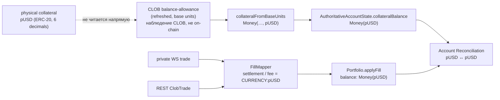

# Canonical collateral Polymarket: pUSD — своя валюта

Деньги Polymarket-аккаунта выражаются в canonical валюте **`pUSD`**, а не
`USDC`. Это закрывает блокер «pUSD vs canonical collateral representation»
перед Account Reconciliation Matcher.

## Проблема

`collateralFromBaseUnits()` (`@polymarket/polymarket-v2`) превращал баланс
площадки в `MoneyService.create(…, 'USDC')`, а `FillMapper` рассчитывал любое
Polymarket-исполнение в `CURRENCY:USDC`. При этом collateral Polymarket CLOB
V2 — pUSD. Документация называла это временным компромиссом, но для matcher-а
он опасен:

```text
Money(100, 'USDC')  ≠  владение 100 физическими pUSD
```

Сверка, сравнивающая «USDC» портфеля с «USDC» площадки, сравнивала бы токен,
которого у аккаунта нет. Кроме того, в двух местах агрегат `Portfolio` молча
переписывал валюту (см. ниже) — и после любого перехода на pUSD принял бы
USDC-исполнение как pUSD.

## Подтверждённый контракт

Перед изменением модели collateral проверен по трём независимым источникам —
предположением он не подменялся:

| источник | что подтверждает |
| --- | --- |
| SDK `@polymarket/client` 0.6.0 (установлен), окружение `production`, chainId 137 | `environment.contracts.collateralToken = 0xC011a7E12a19f7B1f670d46F03B03f3342E82DFB` |
| `docs.polymarket.com/resources/contracts` | «pUSD — CollateralToken Poly v2» — тот же адрес |
| `docs.polymarket.com/concepts/pusd` | «collateral token used for all trading on Polymarket», ERC-20 на Polygon, обеспечен USDC, **6 decimals** |
| `docs.polymarket.com/migrate/polymarket-v2/api-integrations` | `balance-allowance`: «`COLLATERAL` selects pUSD»; «BUY fees add to collateral spend; SELL fees are deducted from proceeds» |
| контракт on-chain (Polygon, `eth_call`) | `symbol() = "pUSD"`, `name() = "Polymarket USD"`, `decimals() = 6` |

Шесть знаков совпадают с `POLYMARKET_BALANCE_DECIMALS = 6`, по которому
`polymarket-v2` уже переводил базовые единицы баланса, — менять перевод не
пришлось.

## Решение: явная валютная идентичность



Вход `collateralFromBaseUnits` — **refreshed-баланс CLOB** (`balance-allowance`
с `COLLATERAL`), а не независимо проверенный on-chain `balanceOf`. Пунктир на
схеме — именно этот разрыв: валюта у наблюдения правильная (pUSD), но его
источник — представление площадки о физическом остатке, и сверка с on-chain
остаётся открытым вопросом (см. «Открытые вопросы для on-chain balance
verification»).

Три запрета:

1. **Нет автоматической конвертации** pUSD ↔ USDC.
2. **Нет отождествления** токенов только потому, что оба номинированы в
   долларах: pUSD обеспечен USDC, но это другой токен.
3. **Нет курса 1:1 в домене.**

### Валюта — идентичность токена

```text
SUPPORTED_CURRENCIES = ['USDC', 'pUSD']        (@polymarket/ids, единый список)

Money.of(100, 'USDC')                          100 USDC
Money.of(100, 'pUSD')                          100 pUSD — другая величина

100 pUSD + 20 pUSD → 120 pUSD
100 USDC + 20 USDC → 120 USDC
100 pUSD + 20 USDC → Err(CURRENCY_MISMATCH)
```

Код валюты каноничен и регистрозависим при разборе — `'pUSD'`, как символ
токена on-chain. `CURRENCY:PUSD` и `'PUSD'` — неизвестная валюта (отказ), а
терпимый ввод приводится к канону: `asSupportedCurrency('PUSD') → 'pUSD'`,
`normalizeCurrency(' pusd ') → 'pUSD'`.

### Одно объявление валюты Polymarket

```typescript
// packages/domain/entities/fill/src/polymarket-collateral.ts
export const POLYMARKET_COLLATERAL_CURRENCY = KnownCurrencies.pUSD;            // 'pUSD'
export const POLYMARKET_COLLATERAL_ASSET_ID: AssetId = AssetIdHelpers.PUSD;    // CURRENCY:pUSD
```

Из него берут валюту все места, где появляются деньги Polymarket-аккаунта:

| что | где | было | стало |
| --- | --- | --- | --- |
| collateral-баланс REST | `collateralFromBaseUnits` (`polymarket-v2`) | `Money(…, 'USDC')` | `Money(…, POLYMARKET_COLLATERAL_CURRENCY)` |
| `Fill.settlementAssetId` TAKER и MAKER | `FillMapper` (`fill`) | `CURRENCY:USDC` | `POLYMARKET_COLLATERAL_ASSET_ID` |
| `Fill.fee`, в том числе нулевая | `FillMapper`, `calculatePolymarketTakerFee*` | `CURRENCY:USDC` | `POLYMARKET_COLLATERAL_ASSET_ID` |

Формулы комиссии и политика ставки taker fee (#111) не менялись — меняется
только идентичность денег, в которых выражен результат.

## Как гарантируется отсутствие смешения

Защита стоит на каждом уровне, где деньги встречаются:

| уровень | правило | отказ |
| --- | --- | --- |
| `Money` core | валюта ∈ `SUPPORTED_CURRENCIES` | `MoneyInvariantViolation` (`UNSUPPORTED_CURRENCY`) |
| `MoneyService` | `add`, `subtract`, `isLessThan…`, `equals` только в одной валюте | `InvalidMoneyError` (`CURRENCY_MISMATCH`) |
| `Balance` core | `available.currency == reserved.currency` | `BalanceInvariantViolation` |
| `BalanceService` | `reserve`, `unfreezeReserved`, `consumeReserved`, `credit`, `updateAvailable` только в валюте баланса | `InvalidBalanceError` (`CURRENCY_MISMATCH`) |
| `Portfolio` | все денежные операции и `applyFill` — в валюте баланса; проверка ДО изменения состояния | `InvalidBalanceError` / `PortfolioOperationError` |
| `AccountHotState` | валюта портфеля аккаунта не меняется; `Fill` рассчитан в валюте портфеля события — и в live `FILL_APPLIED`/`FILL_REVERTED`, и в каждом исполнении сверки (`TRADING_ACCOUNT_RECONCILED`) | `AccountPortfolioIdentityMismatchError` (`balanceCurrency`) |
| `PolymarketAccountVenueStateSource` | collateral от reader-а — только pUSD | `PolymarketAccountStateError` (`balances: collateral must be pUSD…`) |
| `createPolymarketPolicy` | порог `minLiquidity` — только в `MARKET_LIQUIDITY_CURRENCY` (USDC) | `PolicyValidationError` (`minLiquidity.currency`) |

Сверка — отдельный вход в `CONFIRMED`, минуя `Portfolio.applyFill`. Поэтому
`prepareReconciledFills` сверяет валюту расчёта каждого исполнения с валютой
портфеля коррекции тем же `validateFillSettlementCurrency`, что и live-путь:
иначе pUSD-портфель коррекции с USDC-исполнением внутри прошёл бы проверку
портфеля, а исполнение вошло бы в pUSD-аккаунт как `CONFIRMED`. Отказ — до
любых мутаций (портфель, записи исполнений и версии не меняются).

### Что исправлено в `Portfolio`

Две дыры, в которых валюта переписывалась молча:

```text
applyDirectDebit(amount)   → newAvailable = Money.of(…, 'USDC')                  // было
                           → проверка валюты amount, затем Money.of(…, валюта баланса)  // стало

applyFill(fill)            → Money.of(fill.fee…, this.balance.currency())         // было: без сверки
                           → сначала settlementAssetId == CURRENCY:<валюта баланса>,
                             затем перевод сумм Fill                              // стало
```

Плюс `_debitAvailable` (списание комиссии BUY) теперь отвергает сумму в
чужой валюте вместо списания «той же цифры».

```text
Portfolio pUSD + Fill CURRENCY:pUSD  → применяется
Portfolio pUSD + Fill CURRENCY:USDC  → Err до изменения состояния
Portfolio pUSD + reserve 20 USDC     → Err, баланс тот же
```

Мультивалютного `Portfolio` нет: один портфель — один денежный collateral.

## REST/WS parity

Приватный WS (`FillEventHandler`) и REST (`polymarketClobTradeToFillMapperInput`)
идут через **один** `FillMapper`, и валюта расчёта берётся внутри него, а не
у вызывающего. Поэтому:

```text
findFillFactDifference(wsFill, restFill) === undefined
```

остаётся верным: `settlementAssetId` и актив комиссии входят в факт, и у обоих
путей это `CURRENCY:pUSD`. Перевести REST на pUSD и оставить WS на USDC
нельзя по построению; тесты P0 проверяют это для TAKER, одного MAKER,
нескольких MAKER и cross-outcome.

## Сериализация и старые снимки

Валюта хранится как есть, скрытых миграций нет:

| снимок | восстанавливается как |
| --- | --- |
| `Money`/`Balance` JSON с `currency: "USDC"` | USDC |
| `Money`/`Balance` JSON с `currency: "pUSD"` | pUSD |
| `FillSnapshot.settlementAssetId = "CURRENCY:USDC"` | USDC-исполнение |
| `FillSnapshot.settlementAssetId = "CURRENCY:pUSD"` | pUSD-исполнение |
| неизвестная или не канонически написанная валюта (`EUR`, `PUSD`, `usdc`) | отказ |

Старый USDC-портфель остаётся USDC и не принимает pUSD-исполнения Polymarket;
`AccountHotState` не даёт сверке подменить его валюту. Перевод аккаунта на
pUSD — явная переинициализация, а не побочный эффект.

### Старое USDC-исполнение против REST-записи в pUSD

Вопрос: что будет, если исполнение, записанное в USDC до этого MR, встретит
REST-запись с тем же `FillId`, которую `FillMapper` теперь строит в pUSD?
`findFillFactDifference` увидит разный `settlementAssetId`, и сверка вернёт
`AccountFillIdentityConflictError`.

**Почему в текущем рантайме этого не происходит.** Хранилища исполнений нет:

- `AccountHotState` живёт в памяти процесса и строится заново из
  `TRADING_ACCOUNT_INITIALIZED` при каждом старте;
- каждый `Fill` в нём построен в том же процессе тем же `FillMapper`, то есть
  уже в pUSD;
- `FillMapper.fromSnapshot` вне пакета `@polymarket/fill` не вызывается —
  восстановить USDC-исполнение из снимка просто некому.

**Решение, когда появится персистентность.** Конфликт идентичности —
правильный, громкий исход, а не дефект: USDC-запись о pUSD-сделке —
неверный факт, и молча «перекрасить» её в pUSD (или REST-запись в USDC)
значило бы ввести ту самую неявную конвертацию, которую этот MR запрещает.
Будущее хранилище обязано выбрать явно — переинициализацию аккаунта из
venue state или однократную миграцию записей с журналом. Исполнения до
перехода на V2 (до 2026-04-28) — отдельный случай: они рассчитаны в USDC.e и
не должны попадать в scope сверки текущих рынков.

## Инвентаризация жёстко заданного USDC

Не все строки `'USDC'` заменены механически — каждое место отнесено к одной
из двух категорий.

**1. Реальная бизнес-семантика конкретной валюты.** Это деньги
Polymarket-аккаунта; там была неверная валюта, теперь pUSD:

| место | изменение |
| --- | --- |
| `collateralFromBaseUnits` | → `POLYMARKET_COLLATERAL_CURRENCY` |
| `FillMapper` (settlement, fee TAKER/MAKER) | → `POLYMARKET_COLLATERAL_ASSET_ID` |
| `calculatePolymarketTakerFee*` | `Fee` → `POLYMARKET_COLLATERAL_ASSET_ID` |

Мест, где по смыслу требуется именно токен USDC, в текущем коде не найдено.

**2. Историческое ограничение реализации** (другая валюта допустима):

| место | решение в этом MR |
| --- | --- |
| `Portfolio.applyDirectDebit` — `Money.of(…, 'USDC')` | исправлено: валюта баланса + проверка |
| `Money.of` / `MoneyService.create` — умолчание `'USDC'` | оставлено и задокументировано; на нём ≈430 тестовых вызовов и `apps/pnl/src/core/vo.ts`; деньги Polymarket передают валюту явно |
| `PolymarketMarketDiscovery` — ликвидность Gamma в `USDC` | оставлено: это рыночная статистика в долларах, не деньги аккаунта. Валюта вынесена в одно объявление `MARKET_LIQUIDITY_CURRENCY` (`@polymarket/ports`, контракт `MarketDiscoveryMetrics`) |
| policy (`PolicyConfig`, `parsePolicyConfig`, `MarketScorer`) | `minLiquidity` принимается только в `MARKET_LIQUIDITY_CURRENCY`: `pUSD` теперь поддержанная валюта, и порог в ней несопоставим с ликвидностью — `MarketFilter` отклонил бы им каждый рынок без ошибки. `createPolymarketPolicy` отвергает такой порог при сборке (`PolicyValidationError`, поле `minLiquidity.currency`) |
| `ReservationKind = 'USDC' \| 'TOKENS'` (`ports`, `in-memory`) | оставлено: метка денежной резервации в формате записи, `Money` из неё никто не строит; переименование — смена формата хранения |
| `ICurrentBalanceProvider.getUsdcBalance` | оставлено: порт без реализаций |
| `AssetQuantity.usdc()`, `AssetQuantityService.createUsdc()` | оставлено: generic-хелперы USDC, Polymarket ими не пользуется |
| `PortfolioValuationService.getTotalValue(…, currency)` | уже параметризован валютой |

### Минимальный план дальнейших шагов

Массового рефакторинга этот MR не делает. Если понадобится:

1. Убрать умолчание `'USDC'` у `Money.of`/`MoneyService.create` — механический
   MR по тестам (валюта станет обязательной на уровне типов).
2. `ReservationKind`: `'USDC'` → `'COLLATERAL'` вместе с миграцией формата
   записей `IOrderSubmissionRepository`, когда этот контур вернётся в рантайм.
3. Удалить `ICurrentBalanceProvider` или переименовать в collateral-порт.

## Открытые вопросы для on-chain balance verification

On-chain reader в этот MR не входит. Позже (MR #113) решено: первичный
источник состояния аккаунта — CLOB API, независимой on-chain проверки на этом
этапе нет; семантика ответа CLOB — `docs/guides/polymarket-clob-balance-semantics.md`.
Вопросы ниже остаются для on-chain reader-а, если он когда-нибудь понадобится:

| вопрос | почему важен |
| --- | --- |
| чей `balanceOf` читать: proxy/Safe-кошелёк (funder) или EOA-подписант | collateral Polymarket-аккаунта обычно лежит на proxy-кошельке; сейчас идентичность аккаунта — `client.account.wallet` |
| адрес pUSD брать из `client.environment.contracts.collateralToken`, а не из константы | смена окружения или контракта не должна молча читать чужой токен |
| сверять `decimals()` контракта с 6 при старте | перевод базовых единиц завязан на 6 знаков |
| расхождение CLOB `balance-allowance` и on-chain `balanceOf` в окне MATCHED → MINED | CLOB видит исполнение раньше блока |
| USDC.e / нативный USDC на кошельке (до wrap через CollateralOnramp) | это НЕ торговый collateral; в `collateralBalance` попадать не должен |
| redeem и merge: зачисляется ли выплата в pUSD через CollateralAdapter | иначе collateral после резолюции не сойдётся |
| исполнения до перехода площадки на V2 (2026-04-28) рассчитаны в USDC.e | их снимки остаются USDC и не сравниваются с pUSD-балансом. `PolymarketAccountVenueStateSource` читает ВСЕ сделки рынка scope без фильтра по дате: pre-V2 сделка попала бы в проход только на рынке, торговавшемся до перехода и всё ещё входящем в scope (короткие crypto-рынки контура созданы после него). Вернёт ли V2 API такие сделки, не проверено — нужен live-замер или явная граница по `match_time` |

## Тесты

| пакет | файл | что покрывает |
| --- | --- | --- |
| `@polymarket/ids` | `core.test.ts` (`Currency → pUSD`) | список валют, канон и регистр, `CURRENCY:pUSD` ≠ `CURRENCY:USDC` |
| `@polymarket/value-objects` | `money/currency-identity.test.ts` | pUSD создаётся, USDC работает, операции одной валюты, смешение → `Err` (8 операций), сериализация `Money`/`Balance` сохраняет валюту, неизвестная → `Err`, баланс pUSD: reserve/release/consume/credit, чужая валюта → `Err` без изменений |
| `@polymarket/portfolio` | `Portfolio.currency.test.ts` | pUSD available/reserved, резервирование и освобождение pUSD, `applyDirectDebit` pUSD (регрессия USDC-литерала), USDC-операции → `Err` без изменений, pUSD-`Fill` BUY/SELL, USDC-`Fill` → `Err` без изменений, исполнение из `FillMapper` применяется к pUSD-портфелю и не применяется к USDC-портфелю |
| `@polymarket/fill` | `polymarket-fee.test.ts`, `FillMapper.test.ts` | `Fee` и settlement в pUSD (TAKER, MAKER, нулевая комиссия, legacy-путь), снимки USDC/pUSD восстанавливаются как есть, неизвестная валюта → `Err` |
| `@polymarket/polymarket-v2` | `PolymarketClobRefreshedBalanceReader.test.ts`, `PolymarketAccountVenueStateSource.test.ts`, `polymarketAccountMapping.test.ts` | базовые единицы → pUSD, ноль → `Money(0, pUSD)`, невалидные единицы → `Err`, reader с USDC → `Err`, REST и WS — один актив расчёта (TAKER, MAKER, multi-MAKER, cross-outcome) |
| `@polymarket/handlers` | `FillEventHandler.test.ts` | WS-исполнение TAKER/MAKER рассчитывается в pUSD |
| `@polymarket/account-state` | `collateralCurrency.test.ts` | pUSD-портфель принимается; `balanceCurrency` в исполнении, заявке и сверке; USDC-исполнение внутри pUSD-сверки → отказ, ноль мутаций; pUSD-исполнение сверки → `CONFIRMED` |
| `@polymarket/policy` | `createPolicy.test.ts`, `parsePolicyConfig.test.ts` | `minLiquidity` в pUSD отвергается при сборке и при загрузке конфигурации |
| `@polymarket/polymarket-v2` | `PolymarketMarketDiscovery.test.ts` | ликвидность (объявленная и нулевая) — в `MARKET_LIQUIDITY_CURRENCY` |
| `@polymarket/account-reconciliation` | `venueState.types.test.ts` | `collateralBalance` переносит валюту как есть |
