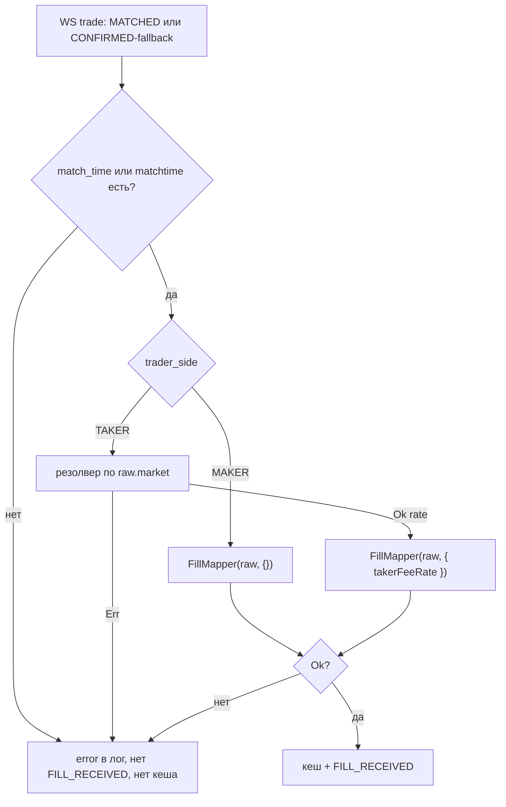

# @polymarket/handlers

## Обзор

Тонкие адаптеры: WS-события Polymarket → `IEventBus` (`@polymarket/event-bus`). Ни один
из трёх handler'ов не содержит доменной логики — только парсинг/маршрутизация входа и
публикация типизированных `ApplicationEvent`. Доменная обработка (Order/Portfolio/Ledger)
живёт ниже по потоку, в `orchestrators` → `use-cases`.

| Handler | Вход | Публикует |
|---|---|---|
| `BookUpdateHandler` | Полный снапшот стакана (`type='book'`) | `BOOK_UPDATED`, `BOOK_DEPTH` |
| `FillEventHandler` | Fill-событие user-channel (`WsFillStatus`) | `FILL_RECEIVED`, `FILL_CONFIRMED`, `FILL_FAILED` |
| `OrderUpdateHandler` | `VenueOrderUpdate` (venue-статус ордера) | `ORDER_UPDATE_RECEIVED` |

`IBookRegistry` — порт реестра `Orderbook`-экземпляров (`@polymarket/orderbook`, immutable
entity) по ключу `(marketId, tokenId)`, которым владеет `BookUpdateHandler`.

## `FillEventHandler`: тот же факт исполнения, что у REST

### Почему

Одно исполнение площадки приходит двумя путями: приватным WS (этот
обработчик) и REST (`PolymarketAccountVenueStateSource` в
`@polymarket/polymarket-v2/account`). Сверка сравнивает их canonical
`findFillFactDifference` — и `Fill.timestamp`, и `Fill.fee` входят в факт.
Раньше WS-путь брал `timestamp` СООБЩЕНИЯ (может быть позже исполнения) и
угадывал комиссию по `fee_rate_bps > 0`; REST — `matchedAt` и ставку рынка.
Один `FillId`, разный факт.

### Как сейчас

```text
Fill.timestamp  ← время исполнения площадки: match_time → legacy matchtime;
                  без обоих — ОТКАЗ, даже при валидном timestamp сообщения;
                  присутствующее, но битое поле → отказ без отката
Fill.fee TAKER  ← ставка PolymarketTakerFeeRateResolver по raw.market
Fill.fee MAKER  ← 0, резолвер не вызывается
fee_rate_bps    ← только диагностика в raw/логах
receivedAt      ← clock.now(): время НАШЕЙ обработки, не время исполнения
```

Официальная схема user-channel Polymarket принимает оба vendor-поля времени
исполнения — `match_time` и legacy `matchtime` (SDK: `matchedAt =
match_time ?? matchtime`). Generic `FillMapper` ради обратной совместимости
откатывается на `timestamp`, если нет обоих. Этот production-путь — нет:
`Fill.timestamp` — неизменяемый факт исполнения на площадке, а `timestamp`
события — время сообщения/обновления. Взять его — значит создать ложный факт:
тот же `FillId`, что у REST (`matchedAt = T`), но со временем `T + 30 с`.

Шаги разбора (`_mapFills` — единственное место, которое вызывает
`FillMapper.allFromPolymarketTradeEvent`; через него идут и MATCHED, и
CONFIRMED-fallback):

1. `_requireVenueExecutionTime`: в событии есть `match_time` или `matchtime`
   (не `undefined`/`null`)? Нет — отказ ДО `FillMapper` и до резолвера.
   Здесь проверяется только присутствие: значение разбирает `FillMapper`
   (`parsePolymarketExecutionTime`), разбор времени живёт в одном месте.
2. `trader_side !== 'TAKER'` → опции `{}` (MAKER комиссию не платит).
3. TAKER: `raw.market` → `asMarketId` (тот же `MarketId`, что `FillMapper`
   положит в `Fill.marketId`) → `takerFeeRates.getTakerFeeRate(marketId)`.
4. `FillMapper.allFromPolymarketTradeEvent(raw, accountId, { takerFeeRate })`:
   `Fill.timestamp` = `match_time`, иначе `matchtime`; битое присутствующее
   поле — отказ без отката.
5. Любой отказ (нет времени исполнения, битое время, невалидный рынок, отказ
   резолвера, невалидная ставка, битое событие) —
   `logger.error('Failed to parse fill event', …)`, `FILL_RECEIVED` не
   публикуется, в `_pendingFills` ничего не попадает. Отката ни на
   `timestamp` сообщения, ни на `fee_rate_bps` нет.



Пример: событие с одним legacy-полем.

```typescript
await handler.handle({ ...trade, matchtime: '1672290700', timestamp: '1672290730' }, accountId);
// FILL_RECEIVED: fill.timestamp = 1672290700000, receivedAt = clock.now()

await handler.handle({ ...trade, timestamp: '1672290730' }, accountId); // ни match_time, ни matchtime
// FILL_RECEIVED нет; logger.error('Failed to parse fill event',
//   { error: 'Invalid trade event: missing venue execution time (match_time or matchtime)', … })
```

Нормальный поток MATCHED → CONFIRMED берёт на CONFIRMED закешированные fills
и ставку повторно не запрашивает.

Резолвер — ОБЯЗАТЕЛЬНАЯ зависимость конструктора: необязательный вернул бы
часть WS-исполнений к угадыванию комиссии. Интерфейс — из `@polymarket/fill`
(не из Infrastructure); реализацию (`PolymarketStaticTakerFeeRateResolver`)
даёт composition root, ТОТ ЖЕ экземпляр, что и REST-адаптеру:

```typescript
const handler = new FillEventHandler(eventBus, metadataGenerator, clock, logger, takerFeeRates);
```

## `IEventBus.publish()` → `Result` (Этап 6 плана миграции)

Все 8 сайтов `.publish()` в пакете проверяют `Result` явно и логируют на `Err`, вместо
падения/проглатывания ошибки молча:

- **`BookUpdateHandler`** (2 сайта: `BOOK_UPDATED`, `BOOK_DEPTH`) — на `Err` логирует через
  `this._logger.error(...)` и продолжает (публикация стакана — fire-and-forget по своей
  природе, следующий снапшот придёт по WS независимо).
- **`OrderUpdateHandler`** (1 сайт) — на `Err` логирует. До Этапа 6 здесь был `try/catch`
  вокруг `publish()` (когда та бросала); теперь это прямая проверка `result.ok` — код стал
  проще, не сложнее, так как `Result` не требует `try/catch` для ожидаемых ошибок.
- **`FillEventHandler`** (5 сайтов) — на `Err` логирует с контекстом (`fillId`/`orderId`) и:
  - в циклах по нескольким fills (`_handleMatchedFill`'s MATCHED-путь, `_handleFailedFill`'s
    maker-путь) — `continue`: сбой публикации одного fill не должен остановить публикацию
    остальных fills того же WS-события;
  - в одиночных путях (`_handleConfirmedFill`'s normal/fallback-публикация,
    `_handleFailedFill`'s taker-путь) — ранний `return`: публиковать больше нечего в рамках
    этого вызова.

Ни один из 8 сайтов не ретраит и не эскалирует ошибку публикации выше — `EventBus`'s
`Result` здесь диагностический (лог), не управляющий поток. Это осознанное продолжение
уже существовавшего до Этапа 6 поведения (`publish()` раньше либо не проверялась вовсе,
либо оборачивалась в `try/catch`, который тоже просто логировал) — Этап 6 меняет механизм
обработки ошибки (`Result` вместо throw/catch), не её семантику.

## `IBookRegistry`/`Orderbook` — immutable-паттерн (Этап 10a плана миграции)

`BookUpdateHandler`/`IBookRegistry` изначально (до Этапа 10a) работали с **mutable**
`OrderBook` (`@polymarket/order-book`, market-data пакет). Этап 6 сознательно не трогал
этот периметр — требовались (а) новый метод интерфейса `IBookRegistry` (иммутабельное
обновление не может мутировать существующий инстанс — реестр обязан явно "положить
обновлённый экземпляр назад") и (б) решение о graceful-деградации при невалидном WS-вводе
в `MarketDataFeedAdapter._convertLevels()` — оба вопроса были явно закреплены за Этапом 10.

Реализовано в Этапе 10a — `IBookRegistry`/`BookUpdateHandler` теперь работают с
**immutable** `Orderbook` (`@polymarket/orderbook`, domain-пакет, `Object.freeze()`):

- `IBookRegistry` получил новый метод `set(marketId, tokenId, book: Orderbook): void` —
  единственный способ "положить" обновлённый снапшот, поскольку мутации существующего
  инстанса больше не бывает.
- `BookUpdateHandler.handleSnapshot()` не читает реестр перед записью (ни `get`, ни
  `getOrCreate`) — Polymarket шлёт только полные снапшоты, поэтому каждый вызов безусловно
  строит новый `Orderbook.fromLevels(...)` и сразу вызывает `this._books.set(...)`.
- `getBestBid()`/`getBestAsk()` возвращают `OutcomePrice | null` (не `PriceLevel | undefined`) —
  размер лучшего уровня читается отдельно через `book.bids[0]?.quantity`/
  `book.asks[0]?.quantity`.
- `getSpread()` возвращает `Result<Spread, OrderbookInvalidError>` — заменяет отдельную
  проверку `rawSpread.gt(0)`, которая была нужна старому API (`getSpread()` уже сам
  отсеивает `EMPTY_BOOK`/`ONE_SIDED`/`CROSSED_BOOK` через `Err`).
- `MarketDataFeedAdapter._convertLevels()`/`BacktestEngine._convertLevels()` сохранили
  прежнюю throw-and-skip форму (`OutcomePrice.of()`/`Quantity.of()` в try/catch, невалидный
  уровень пропускается с debug-логом, а не роняет весь снапшот) — просто строят
  `OrderbookLevel.create(price, quantity)` вместо старого `{price, size}`-литерала.
- Полная схема (нейминговый нюанс `instrumentId`-параметра, реальный код
  `BookUpdateHandler`, `BookDepthCollector`'s `RollingWindow<Orderbook>`) —
  `packages/domain/entities/orderbook/docs/orderbook-entity.md`, раздел "Реальное
  подключение".

## Ссылки

- ADR: `docs/architecture/boundary-contract.md`
- `@polymarket/event-bus/docs/event-bus.md` — контракт `IEventBus`, deprecation-мост
- `@polymarket/orderbook/docs/orderbook-entity.md` — раздел "Реальное подключение"
- План миграции, Этапы 6 и 10a: `/Users/menvil/.claude/plans/synthetic-swimming-heron.md`
