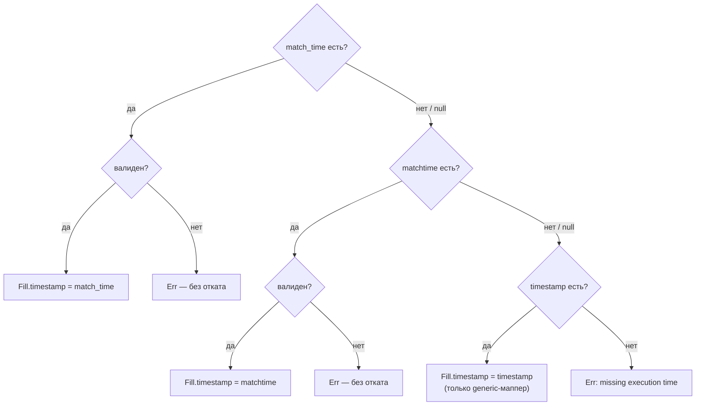

# Fill Entity

## Что такое Fill

`Fill` — запись об исполнении нашего конкретного ордера на торговой площадке. Представляет факт того, что наш ордер был (частично) исполнен.

Используется для:

- Расчёта позиций (position tracking)
- Расчёта PnL
- Учёта комиссий
- Входной записи для Ledger layer

## Чем Fill НЕ является

Fill **НЕ** является рыночным принтом (market tape). Для аналитики рынка используется `Trade`.

## Пакет

```
packages/domain/entities/fill/
```

Экспортируется как `@polymarket/fill` (только для внутреннего использования через project references).

## Структура

```
src/
  Fill.ts                      # Основная сущность (Domain Record)
  FillSnapshot.ts              # Плоское DTO для хранения
  AssetDelta.ts                # Тип для знаковых изменений баланса
  ExecutionMetadata.ts         # Инфраструктурные метаданные
  index.ts
  value-objects/
    Liquidity.ts               # 'MAKER' | 'TAKER'
  mappers/
    FillMapper.ts              # fromPolymarketTradeEvent, toSnapshot, fromSnapshot
```

## Интерфейс FillParams

```typescript
interface FillParams {
  readonly id: FillId;                  // Уникальный ID исполнения (UUID из трейд-события)
  readonly orderId: OrderId;            // ID ордера — ОБЯЗАТЕЛЕН
  readonly accountId: AccountId;        // ID аккаунта
  readonly venueId: VenueId;            // Биржа (POLYMARKET)
  readonly marketId: string;            // ID рынка
  readonly tokenId: AssetId;            // ID outcome токена
  readonly settlementAssetId: AssetId;  // Расчётная валюта (CURRENCY:pUSD для Polymarket CLOB V2)
  readonly price: OutcomePrice;                // Цена исполнения
  readonly size: Quantity;              // Объём исполнения
  readonly side: Side;                  // BUY | SELL
  readonly timestamp: Timestamp;        // Время исполнения
  readonly fee: Fee;                    // Комиссия (>= 0)
}
```

### Ключевые свойства

- `orderId` всегда обязателен. Нет orderId — нет Fill.
- `settlementAssetId` определяет расчётную валюту. У Polymarket CLOB V2 это
  `CURRENCY:pUSD` (`POLYMARKET_COLLATERAL_ASSET_ID`), см. «Деньги исполнения
  Polymarket — pUSD» ниже.
- `liquidity` и `venueTradeId` — инфраструктурные метаданные, вынесены в `ExecutionMetadata`.

## Инварианты

`Fill.create()` проверяет:

1. `marketId` не пустая строка
2. `size > 0`
3. Если fee ненулевая — `fee.asset === settlementAssetId` (fee в расчётной валюте)

Остальные поля валидируются своими типами (branded types + Value Objects).

## Методы — экономические расчёты

```typescript
// Signed изменения баланса (AssetDelta = { asset: AssetId; amount: SignedQuantity })
getSignedQuantity(): AssetDelta   // { asset: tokenId, amount: ±size }   токен
getCashFlow(): AssetDelta         // { asset: settlementAssetId, amount: ∓(price×size) }
getFeeFlow(): AssetDelta          // { asset: settlementAssetId, amount: -feeAmount }
getNetCashFlow(): AssetDelta      // { asset: settlementAssetId, amount: cashFlow + feeFlow }

// Неотрицательная стоимость (AssetQuantity)
getNotional(): AssetQuantity      // { asset: settlementAssetId, amount: price×size }

// Предикаты
isBuy(): boolean                  // side === 'BUY'
isSell(): boolean                 // side === 'SELL'
hasFee(): boolean                 // fee.amount > 0
```

## AssetDelta

```typescript
interface AssetDelta {
  readonly asset: AssetId;
  readonly amount: SignedQuantity;  // знаковый VO: + кредит, − дебет
}
```

Используется для расчётов в Ledger layer.

## ExecutionMetadata

```typescript
interface ExecutionMetadata {
  readonly venueTradeId?: VenueTradeId;  // хэш транзакции → сшивка с Trade
  readonly liquidity?: Liquidity;        // MAKER | TAKER
  readonly tradeStatus?: TradeStatus;    // MATCHED | MINED | CONFIRMED | RETRYING | FAILED
}
```

Содержит инфраструктурные данные, не влияющие на доменную экономику Fill.

## Политика наблюдений за TradeStatus

`tradeStatus` наблюдается по сети, и наблюдения приходят не в том порядке, в
котором происходили. Правило, как поступать с пришедшим статусом, живёт здесь —
в `src/tradeStatus.ts`.

```typescript
isTerminalTradeStatus(status);                        // CONFIRMED | FAILED
classifyTradeStatusObservation(current, incoming);
// → 'ACCEPT' | 'DUPLICATE' | 'STALE' | 'CONFLICT'
```

### Почему это домен, а не потребитель

Правило выводится целиком из контракта `TradeStatus`: какие статусы финальны и
куда площадка из них ходит. Оно не зависит ни от того, кто наблюдает, ни от
того, где хранится результат. Раньше оно жило в `@polymarket/account-state` —
там оно было недоступно другим потребителям и повторилось бы в следующем.

### Правило

```text
current == incoming                DUPLICATE
терминальный → нетерминальный      STALE
терминальный → другой терминальный CONFLICT
нетерминальный → любой             ACCEPT
```

Различать порядок СОБЫТИЙ и порядок ДОСТАВКИ обязательно. Площадка назад не
ходит; сообщения приходят как придётся:

```text
площадка:   MATCHED → MINED → CONFIRMED
доставка:   MATCHED → CONFIRMED → MINED
                                  ↑ старое наблюдение доехало последним
```

`MINED` после `CONFIRMED` не означает, что сделка перестала быть
подтверждённой, — отсюда `STALE`, а не ошибка. Возвращать по такому наблюдению
отказ нельзя: у потребителя оно обычно приходит по подписке, и штатное
переупорядочивание сети превращалось бы в аварийный отказ.

Задержкой не объясняются только два РАЗНЫХ терминальных исхода одной сделки:

```text
CONFIRMED  «finality достигнута, транзакция успешна»
FAILED     «окончательно упала, повторов не будет»
```

Одна сделка не может быть и тем, и другим — это единственный настоящий
конфликт.

### Что функция НЕ делает

Не бросает, не логирует и не знает, чем `CONFLICT` обернётся выше — ошибкой,
метрикой или сверкой. Это решает потребитель.

`current` не принимает `undefined`: отсутствие наблюдений — не вопрос политики,
первое наблюдение принимается всегда. Будь аргумент необязательным, вызывающему
пришлось бы приводить тип в ветке `CONFLICT`, потому что компилятор не проносит
сужение через вызов.

## Liquidity Value Object

```typescript
export type Liquidity = 'MAKER' | 'TAKER';
export const ALL_LIQUIDITY: readonly Liquidity[] = ['MAKER', 'TAKER'];
export function isValidLiquidity(v: unknown): v is Liquidity;
```

## Деньги исполнения Polymarket — pUSD (`polymarket-collateral.ts`)

### Почему

Polymarket CLOB V2 торгует и рассчитывается в **pUSD** (Polymarket USD), а не
в USDC. Подтверждено тремя источниками:

| источник | что говорит |
|---|---|
| SDK `@polymarket/client` 0.6.0, production (chainId 137) | `environment.contracts.collateralToken = 0xC011a7E12a19f7B1f670d46F03B03f3342E82DFB` |
| `docs.polymarket.com/resources/contracts` | «pUSD — CollateralToken Poly v2» — тот же адрес |
| `docs.polymarket.com/concepts/pusd` | «collateral token used for all trading», 6 decimals, обеспечен USDC |
| контракт on-chain | `symbol() = "pUSD"`, `name() = "Polymarket USD"`, `decimals() = 6` |

Раньше `FillMapper` рассчитывал любое Polymarket-исполнение в `CURRENCY:USDC`
— исполнение выглядело расчётом в токене, которого у аккаунта нет.

### Как сейчас

Единственное объявление валюты денег Polymarket-аккаунта:

```typescript
import { POLYMARKET_COLLATERAL_ASSET_ID, POLYMARKET_COLLATERAL_CURRENCY } from '@polymarket/fill';

POLYMARKET_COLLATERAL_CURRENCY;                  // 'pUSD'
assetIdToString(POLYMARKET_COLLATERAL_ASSET_ID); // 'CURRENCY:pUSD'
```

| что | откуда валюта |
|---|---|
| `Fill.settlementAssetId` TAKER и MAKER | `POLYMARKET_COLLATERAL_ASSET_ID` (`FillMapper`) |
| `Fill.fee` (в том числе нулевая) | `POLYMARKET_COLLATERAL_ASSET_ID` (`calculatePolymarketTakerFee*`, `FillMapper`) |
| REST collateral-баланс | `POLYMARKET_COLLATERAL_CURRENCY` (`collateralFromBaseUnits` в `polymarket-v2`) |

Приватный WS и REST идут через ОДИН `FillMapper`, поэтому актив расчёта у
одного исполнения один и тот же: `findFillFactDifference(wsFill, restFill)`
сравнивает и `settlementAssetId`, и актив комиссии. Перевести REST на pUSD и
оставить WS на USDC невозможно по построению.

Снапшоты хранят актив как есть: старый `CURRENCY:USDC` восстанавливается
как USDC, `CURRENCY:pUSD` — как pUSD, неизвестная или не канонически
написанная валюта (`CURRENCY:EUR`, `CURRENCY:PUSD`) — отказ. Скрытой
миграции нет.

## polymarket-fee.ts

Формула taker-комиссии Polymarket для crypto-рынков: `fee = size × feeRate × p × (1 - p)`
(округление до 5 знаков, ROUND_HALF_UP; меньше `POLYMARKET_MIN_FEE` = 0.00001 → 0;
прежнее имя `POLYMARKET_MIN_FEE_USDC` оставлено как `@deprecated`-синоним).
`Fee` выражен в pUSD — collateral площадки; формула от валюты не зависит.

```typescript
// VO-based (Этап 3 плана миграции) — по ADR Decimal легитимен только внутри
// value-objects/math, публичная граница здесь типизирована через Quantity/OutcomePrice/Fee
calculatePolymarketTakerFee(size: Quantity, price: OutcomePrice): Fee
calculatePolymarketTakerFeeWithRate(size: Quantity, price: OutcomePrice, feeRate: number | Decimal): Fee

// Примитивы (не переводится на VO — сигнатура уже полностью на number,
// потребители: стратегии и PnL-инструмент (удалены), domain/cross-market)
calculatePolymarketTakerFeeNumber(size: number, price: number, feeRate?: number): number
```

`calculatePolymarketTakerFeeNumber` сохраняет старый контракт "невалидный вход (NaN,
Infinity, price вне [0.0001, 0.9999], size/feeRate <= 0) → тихо `0`, не throw" —
guard-проверки выполняются на сырых `number` до конструирования `Quantity`/`OutcomePrice` VO
(которые бросают исключение при значении вне инварианта).

## FillMapper

### fromPolymarketTradeEvent

Парсит trade событие из Polymarket user-channel WebSocket:

```typescript
FillMapper.fromPolymarketTradeEvent(
  raw: Record<string, unknown>,
  accountId: AccountId          // из сессионного контекста, не из события
): Result<{ fill: Fill; metadata: ExecutionMetadata }, ValidationError>
```

**Формат входного события** (Polymarket user-channel):

```json
{
  "id": "28c4d2eb-bbea-40e7-a9f0-b2fdb56b2c2e",
  "taker_order_id": "0x06bc63...",
  "market": "0xbd31dc8a...",
  "asset_id": "OUTCOME_TOKEN:ONCHAIN:POLYMARKET_CTF:137:0x...:YES",
  "side": "BUY",
  "size": "10",
  "price": "0.57",
  "fee_rate_bps": "20",
  "status": "MATCHED",
  "owner": "9180014b-...",
  "match_time": "1672290700",
  "timestamp": "1672290701",
  "trader_side": "TAKER",
  "transaction_hash": "0xabcdef...",
  "maker_orders": [{ "order_id": "0xff...", "matched_amount": "10", "price": "0.57", "owner": "uuid" }]
}
```

**Время исполнения (`Fill.timestamp`) — время исполнения площадки, а не время
сообщения.** Официальная схема user-channel Polymarket принимает ОБА
vendor-поля времени исполнения — `match_time` и legacy `matchtime`; SDK
нормализует их как `matchedAt = match_time ?? matchtime`. `FillMapper` идёт в
том же порядке и только потом — к `timestamp`:

| `match_time` | `matchtime` | `Fill.timestamp` |
| --- | --- | --- |
| есть и валиден | любой | `match_time` |
| есть, но невалиден (пустой, нечисловой, `NaN`, ≤ 0, не строка/число) | любой | `Err(ValidationError)` — БЕЗ отката на `matchtime` и `timestamp` |
| отсутствует (`undefined`) или `null` | есть и валиден | `matchtime` |
| отсутствует или `null` | есть, но невалиден | `Err(ValidationError)` — БЕЗ отката на `timestamp` |
| отсутствует или `null` | отсутствует или `null` | `timestamp` (тот же разбор; нет и его — `Err`) |



Значение `< 1e12` — секунды (× 1000), иначе миллисекунды; правило одно для
всех трёх полей, часы не используются. Выбор поля — одна функция
`parsePolymarketExecutionTime`, разбор выбранного значения — одна
`parseExecutionTimestamp`.

Почему так: `timestamp` WS-события — время СООБЩЕНИЯ/обновления, оно может
быть позже исполнения (повторная доставка, `MATCHED → CONFIRMED`). А
`Fill.timestamp` входит в неизменяемый факт (`findFillFactDifference`): с
временем доставки одно исполнение дало бы из WS и из REST (`matchedAt`) один
`FillId`, но разный факт. Событие с одним `matchtime` — тоже событие с
известным временем исполнения: без поддержки legacy-имени маппер взял бы
`timestamp = T + 30 с` при REST `matchedAt = T`. Первое присутствующее поле
времени исполнения — authoritative попытка: откат при испорченном значении
скрыл бы испорченное время исполнения другим полем — поэтому отказ.
REST-адаптер передаёт `matchedAt` под именем `match_time`.

Откат на `timestamp` остаётся в generic-маппере только ради обратной
совместимости (прочие вызывающие, исторические записи). Приватный
production-путь строже: `FillEventHandler` отвергает сделку без `match_time`
и `matchtime` ещё до `FillMapper` — одного `timestamp` сообщения ему мало
(см. `packages/application/handlers/docs/handlers.md`).

**Логика TAKER vs MAKER:**

| Поле | TAKER | MAKER |
|------|-------|-------|
| `orderId` | `taker_order_id` | `maker_orders[n].order_id` (по owner UUID) |
| `side` | `side` | инвертированный `side` |
| `size` | `size` | `maker_orders[n].matched_amount` |
| `price` | `price` | `maker_orders[n].price` |

**Расчёт комиссии:**

`fee_rate_bps` из события используется только как флаг "комиссия ненулевая" (значение
`fee_rate_bps` в бинарных рынках Polymarket всегда одно и то же для taker — 0 или "есть
комиссия"; к MAKER не применяется вообще, MAKER fee = 0). Реальная формула — через
`calculatePolymarketTakerFee(size, price)` (см. `polymarket-fee.ts` ниже), не через сам
`fee_rate_bps`:

```
fee = size × POLYMARKET_CRYPTO_TAKER_FEE_RATE × price × (1 - price)
```

**Ставка из надёжного источника: `allFromPolymarketTradeEvent(raw, accountId, options)`.**

`allFromPolymarketTradeEvent` (все наши исполнения сделки, включая multi-maker)
принимает необязательные опции:

```typescript
interface PolymarketTradeEventMappingOptions {
  /** Ставка taker-комиссии рынка (доля, например 0.07) */
  readonly takerFeeRate?: number;
}
```

| сторона | `takerFeeRate` | комиссия |
| --- | --- | --- |
| MAKER | любое | 0 |
| TAKER | задана | `calculatePolymarketTakerFeeWithRate(size, price, takerFeeRate)`; `fee_rate_bps` события игнорируется |
| TAKER | не задана | прежнее правило: `fee_rate_bps > 0` → `calculatePolymarketTakerFee` |

Почему так: `fee` входит в canonical факт исполнения (`findFillFactDifference`).
Аутентифицированный REST (`listAccountTrades`) отдаёт `feeRateBps: "0"` и у
тейкерской сделки, за которую площадка взяла комиссию, а `fee_rate_bps`
приватного WS заполнен случайно. Правило «по `fee_rate_bps`» давало одному
исполнению разную комиссию: один `FillId`, разный факт. Поэтому ОБА
production-пути передают ставку, полученную по рынку исполнения:

| путь | откуда ставка | `fee_rate_bps` / `feeRateBps` |
| --- | --- | --- |
| приватный WS (`FillEventHandler`, `@polymarket/handlers`) | `PolymarketTakerFeeRateResolver` по `raw.market`, только TAKER | диагностика, на комиссию не влияет |
| REST (`PolymarketAccountVenueStateSource`, `@polymarket/polymarket-v2/account`) | тот же порт по `conditionId`, только TAKER | не передаётся в `FillMapper` |

Ставка обязана быть конечной и неотрицательной; иначе — `Err(ValidationError)`.
Legacy-правило без опции остаётся для прочих вызывающих и тестов.

### Порт `PolymarketTakerFeeRateResolver`

Контракт ставки объявлен здесь, в `@polymarket/fill`, рядом с `FillMapper` и
`polymarket-fee`: приватный WS-обработчик живёт в Application и не может
импортировать Infrastructure, где лежит реализация.

```typescript
export interface PolymarketTakerFeeRateResolver {
  /** condition id исполнения → ставка ДОЛЕЙ (0.07, не bps); неизвестный рынок → Err */
  getTakerFeeRate(marketId: MarketId): Result<number, Error>;
}
```

```text
@polymarket/fill            PolymarketTakerFeeRateResolver (единственная декларация)
  ↑ import type                     ↑ implements
@polymarket/handlers        @polymarket/polymarket-v2
FillEventHandler (WS)       PolymarketStaticTakerFeeRateResolver; /account re-export типа
```

Ставки по умолчанию нет: неизвестный рынок — отказ разбора исполнения, а не
«0» и не глобальная `0.07`.

```typescript
const fills = FillMapper.allFromPolymarketTradeEvent(raw, accountId, {
  takerFeeRate: POLYMARKET_CRYPTO_TAKER_FEE_RATE,
});
```

**Маппинг в ExecutionMetadata:**

- `trader_side` → `liquidity` ('MAKER' | 'TAKER')
- `status` → `tradeStatus` ('MATCHED' | 'MINED' | 'CONFIRMED' | 'RETRYING' | 'FAILED')
- `transaction_hash` → `venueTradeId`

### toSnapshot / fromSnapshot

Round-trip сериализация через `FillSnapshot` (плоские примитивы).
`tradeStatus` сохраняется в снапшоте и восстанавливается.

**Точность (Этап 3 плана миграции)**: `price`/`size`/`feeAmount` сериализуются как
**строки** (было `number` — при экстремальных значениях возможна потеря точности
Decimal через IEEE-754 double; `.toString()` сохраняет точность, `.toNumber()`
раньше — нет). `timestampMs` остаётся `number` — epoch ms, целое число, не Decimal-
значение. `fromSnapshot()`'s парсинг (`new Decimal(snapshot.price)`) не потребовал
изменений — `Decimal`-конструктор одинаково принимает `string` и `number`.

## Пример использования

```typescript
import { FillMapper } from '@polymarket/fill';
import { parseAccountId } from '@polymarket/ids';

const accountId = parseAccountId('wallet:0x1234...')!;

const result = FillMapper.fromPolymarketTradeEvent({
  id: '28c4d2eb-bbea-40e7-a9f0-b2fdb56b2c2e',
  taker_order_id: '0x06bc63...',
  market: '0xbd31dc8a...',
  asset_id: 'OUTCOME_TOKEN:ONCHAIN:POLYMARKET_CTF:137:0x...:YES',
  price: '0.65',
  size: '50',
  side: 'BUY',
  fee_rate_bps: '20',
  status: 'MATCHED',
  match_time: '1700000000',   // момент исполнения → fill.timestamp
  timestamp: '1700000005',    // время сообщения — не участвует, раз есть match_time
  trader_side: 'TAKER',
  transaction_hash: '0xabc...',
}, accountId);

if (result.ok) {
  const { fill, metadata } = result.value;
  console.log(fill.getCashFlow().amount.toNumber()); // -32.5 (price × size = 0.65 × 50)
  console.log(fill.hasFee());                        // true (50 × 0.07 × 0.65 × 0.35 ≈ 0.79625)
  console.log(fill.timestamp.toNumber());            // 1700000000000 (match_time)
  console.log(metadata.liquidity);                   // 'TAKER'
  console.log(metadata.tradeStatus);                 // 'MATCHED'
}
```

## Связь с Ledger

Fill → `FillLedgerAdapter.toLedgerEntries(fill)` → `LedgerEntry[]` → `Ledger`

```
BUY без комиссии → 2 записи: POSITION_DELTA (+token), CASH_DELTA (−settlement)
BUY с комиссией  → 3 записи: POSITION_DELTA (+token), CASH_DELTA (−settlement), FEE_DEBIT (−settlement)
```

## Связь с Order

Fill применяется к Order через `Order.applyFill(fill: FillData)`.

```
Order.applyFill(fill) → ORDER_PARTIALLY_FILLED | ORDER_FILLED event
  → обновить filledSize + averagePrice + OrderStatus
```

## Связь с Trade

Fill может опционально ссылаться на Trade через `ExecutionMetadata.venueTradeId`:

```
metadata.venueTradeId → Trade.id (рыночный принт)
```

Связка устанавливается в application layer через `ExecutionLinker`. Fill является **источником истины** для расчётов позиций — Trade лишь предоставляет рыночный контекст.
