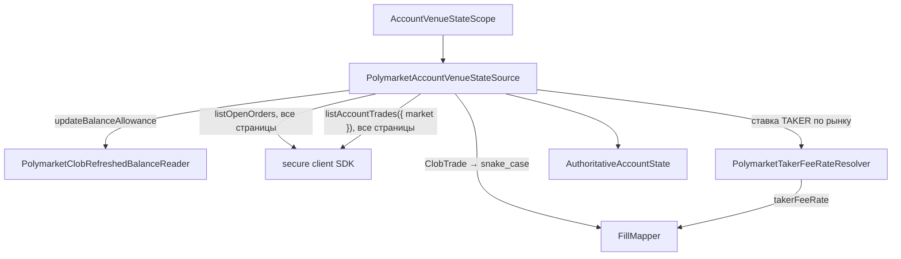
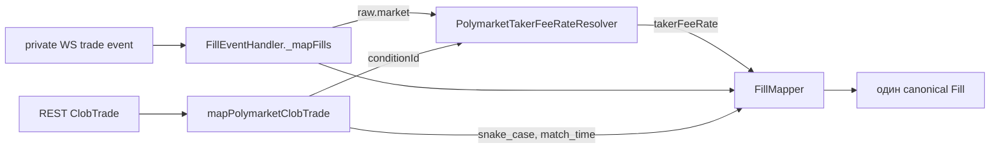

# Account venue state source (account plane)

`PolymarketAccountVenueStateSource` — production-адаптер порта
`IAccountVenueStateSource` (`@polymarket/account-reconciliation`) на
официальном `@polymarket/client` 0.6.x. Точка входа —
`@polymarket/polymarket-v2/account`, а не корень пакета: account plane в
runtime тянет порт сверки и `@polymarket/fill`, и потребители data/control-
плоскостей (сборщик, recorder, finalizer) не должны загружать этот стек. Контракт порта и его семантика
(scope, `recentFills`, текущее состояние площадки побеждает историю событий)
описаны в README `@polymarket/account-reconciliation` и в
`docs/guides/account-venue-state.md`; здесь — как адаптер их выполняет.

## Проблема

Сверке нужно authoritative текущее состояние аккаунта на площадке — но не
вся его история. Рантайм торгует на 1–4 рынках и совершает на каждом десятки
операций. Читать account-wide листинг позиций и всю историю сделок значит
зависеть от фильтров и пагинации, не нужных scoped-рантайму, и тянуть
старые рынки бесконечно.

## Решение

```text
AccountVenueStateScope
        ↓
PolymarketAccountVenueStateSource
        ├── refreshed collateral                (весь аккаунт)
        ├── scoped token balances               (каждый актив scope, ноль явно)
        ├── account-wide open orders            (все страницы SDK)
        └── complete trades of scoped markets   (каждый рынок scope, все страницы)
        ↓
AuthoritativeAccountState
```

```text
NO listPositions
NO lifetime trade scan
NO strategy ownership assumption
NO Portfolio construction
NO reconciliation/mutation
```

Адаптер — request/response-порт: он НЕ публикует ни `ExternalMessage`, ни
`ApplicationEvent`. Обе шины репозитория остаются неизменными.



## Создание: конфигурация привязана к аккаунту клиента

`FillMapper` строит исполнения с `config.accountId`, а балансы читают клиент
и reader. Поэтому поздняя проверка «исполнение принадлежит аккаунту» не
увидит расхождения конфигурации с клиентом: исполнения получают
настроенный аккаунт по построению. Привязка проверяется в `create()` — по
доверенной идентичности самих зависимостей, а не по конфигурации:

```text
client.account.wallet       кошелёк, выставленный аутентификацией SDK (AccountIdentity.wallet)
balanceReader.boundWallet   кошелёк, балансы которого читает reader
                            (CLOB-reader: client.account.wallet того же клиента)
```

| проверка | отказ |
| --- | --- |
| `client.account.wallet` читается и это EVM-адрес | `bound account: secure client wallet is not an EVM address …`, `bound account: dependency did not report its wallet` |
| `balanceReader.boundWallet` = кошелёк клиента | `bound account: balance reader is bound to …, secure client to …` |
| `makerAddress` = кошелёк клиента | `bound account: maker address … is not the secure client wallet …` |
| `accountId` = `wallet:<кошелёк клиента>` (`accountIdFromWallet`) | `bound account: configured account … is not the secure client account …` |

Регистр адресов не важен. `accountId` другого вида (`VENUE`, `SUBACCOUNT`)
с кошельком клиента не сверить — это тоже отказ (fail closed). Отказ
создания не делает ни одного запроса к API.

## Шаги `getAccountState(venueId, accountId, scope)`

1. **Идентичность.** `venueId` и `accountId` (через `accountIdEquals`)
   обязаны совпасть с настроенными; иначе `Err` без единого запроса.
2. **Scope.** Дубликат актива или рынка, рынок не в форме condition id —
   `Err` до запросов. Scope — множество; молчаливый dedupe скрыл бы ошибку
   вызывающего, а не-condition-id дал бы пустую выборку сделок, неотличимую
   от «сделок не было». Scope копируется до проверки: массивы вызывающего
   читаются и после `await`, и их правка во время прохода сдвинула бы
   балансы на чужие активы.
3. **Балансы** — параллельно через `PolymarketAuthoritativeBalanceReader`:
   collateral и КАЖДЫЙ актив scope. Результат — ровно по записи на актив,
   ноль явно. Это ПОЛНОЕ владение (вместе с тем, что под открытыми
   заявками), а не доступный остаток.
4. **Открытые заявки** — `listOpenOrders()` без фильтра по рынку, все
   страницы последовательно. Каждая — `LIVE`; иначе `Err`. Повтор `orderId` —
   `Err`. `maker_address` каждой — кошелёк аккаунта; иначе `Err`
   (`checkPolymarketOrderMaker`: эндпоинт ограничен API-ключом, а не адресом).
5. **Сделки** — для каждого рынка scope `listAccountTrades({ market })`, все
   страницы; рынки параллельно. Фильтр `makerAddress` НЕ передаётся:
   эндпоинт уже ограничен аккаунтом, а legacy наблюдал, что maker-фильтр
   скрывает taker-сделки.
6. **Исполнения** — каждая сделка через `FillMapper` (см. ниже); комиссия
   TAKER — по ставке `PolymarketTakerFeeRateResolver` рынка сделки, а не по
   `feeRateBps` ответа. Затем слияние повторов, проверка аккаунта, площадки
   `POLYMARKET` и рынка scope.
7. **Ответ** — одно `AuthoritativeAccountState`. Отказ любого шага — `Err`
   всего прохода; уже прочитанные страницы наружу не уходят.

`recentFills` для коротких текущих рынков фактически содержит ВСЕ сделки
аккаунта на рынках scope. Это по-прежнему ограниченное свидетельство
текущего торгового контура, а не история аккаунта.

## Балансы: обновлённый CLOB-взгляд

**`balance` — полное владение адреса токеном, включая то, что стоит под
открытыми заявками; `allowances` — разрешения spender-контрактам, не
владение.** Доказательства, примеры и окно «сделок в полёте» —
`docs/guides/polymarket-clob-balance-semantics.md`. Matcher сравнивает
`balance` с `available + reserved`, а резервацию выводит из `openOrders`.

Первичный источник состояния аккаунта — CLOB API (архитектурное решение);
независимой on-chain проверки нет.

`PolymarketClobRefreshedBalanceReader` читает через `updateBalanceAllowance`, а
не `fetchBalanceAllowance`:

```text
updateBalanceAllowance = GET /balance-allowance/update → GET /balance-allowance
```

```text
This reader is a refreshed CLOB balance reader.
It MUST NOT be treated as independently verified on-chain truth.
A production composition that requires physical inventory truth may
replace/wrap it with an on-chain verifier without changing
PolymarketAccountVenueStateSource.
It MUST NOT silently convert transport/schema failures to zero.
```

Authoritative здесь — порт `PolymarketAuthoritativeBalanceReader` и
источник состояния: гарантию «фактического» баланса даёт reader, который
внедрил composition root. Конкретный `PolymarketClobRefreshedBalanceReader`
отдаёт обновлённый ВЗГЛЯД CLOB, а не доказательство on-chain владения
(legacy «фантомный MINT»). RPC/ERC-20/ERC-1155 `balanceOf` в этом MR не
реализован.

`balance` — целое в базовых единицах с шестью знаками. Перевод — сдвигом
запятой в строке, без `number`:

```text
"1234567" → "1.234567"        "1" → "0.000001"        "0" → 0 (настоящий ноль)
undefined / NaN / "-5" / "1.5" / "1e6" / " 5" / 23+ цифр → Err
```

### Collateral — pUSD, отдельная canonical валюта

`COLLATERAL` у Polymarket CLOB V2 — это **pUSD** (Polymarket USD), а не USDC:

| источник | что подтверждает |
| --- | --- |
| SDK `@polymarket/client` 0.6.0, production (chainId 137) | `environment.contracts.collateralToken = 0xC011a7E12a19f7B1f670d46F03B03f3342E82DFB` |
| `docs.polymarket.com/resources/contracts` | «pUSD — CollateralToken Poly v2», тот же адрес |
| `docs.polymarket.com/migrate/polymarket-v2/api-integrations` | «`COLLATERAL` selects pUSD» для `balance-allowance` |
| `docs.polymarket.com/concepts/pusd` | collateral всей торговли, 6 decimals, обеспечен USDC |
| контракт on-chain (Polygon) | `symbol() = "pUSD"`, `name() = "Polymarket USD"`, `decimals() = 6` |

Поэтому `collateralFromBaseUnits` создаёт `Money` в canonical валюте `pUSD`
(`POLYMARKET_COLLATERAL_CURRENCY` из `@polymarket/fill` — того же
объявления, из которого `FillMapper` берёт валюту расчёта исполнений), без
какого-либо курса pUSD ↔ USDC. Шесть знаков базовых единиц совпадают с
`decimals()` контракта.

Reader внедряется, и его может заменить on-chain верификатор. Поэтому
`getAccountState` проверяет валюту collateral от reader-а: `Money` не в
`pUSD` — отказ прохода (`balances: collateral must be pUSD, reader returned
USDC`), а не доллары «примерно те же».

## Заявки: статус CLOB + `sizeMatched`

Документированные статусы заявки CLOB: `LIVE`, `MATCHED`, `CANCELED`,
`CANCELED_MARKET_RESOLVED`, `INVALID`. `original_size`/`size_matched` уже
нормализованы в shares (делить на 1e6 не нужно).

| статус CLOB | `sizeMatched` | canonical |
| --- | --- | --- |
| `LIVE` | 0 | `OPEN` |
| `LIVE` | 0 < m < size | `PARTIALLY_FILLED` |
| `LIVE` | = size | `Err` |
| `MATCHED` | = size | `FILLED` |
| `MATCHED` | < size | `Err` |
| `CANCELED`, `CANCELED_MARKET_RESOLVED` | < size | `CANCELED` |
| `CANCELED`, `CANCELED_MARKET_RESOLVED` | = size | `Err` |
| `INVALID`, `DELAYED`, `UNMATCHED`, регистр, пустой, незнакомый | — | `Err` |
| любой | > size | `Err` |

`REJECTED` и `EXPIRED` этим путём не производятся — их площадка так не
сообщает, и они не угадываются. Ручная заявка без стратегических метаданных
переводится так же, как наша.

`getOrderState(orderId)` — `fetchOrder({ orderId })`:

```text
200                                 → AuthoritativeOrderState (в т. ч. терминальное)
RequestRejectedError, status 404    → Ok(undefined)   ("Order not found")
401 / 403 / 429 / 500 / транспорт / схема / любое другое → Err
ответ с другим id                   → Err
```

404 распознаётся структурно (`name === 'RequestRejectedError'` и
`status === 404`), а не `instanceof`: runtime-код SDK пакет не загружает.

## Сделки: одно правило `FillId` с приватным WS

REST `ClobTrade` переводится в snake_case-форму WS-события и разбирается
ТЕМ ЖЕ `FillMapper.allFromPolymarketTradeEvent`:

| REST (`ClobTrade`) | WS-форма для `FillMapper` |
| --- | --- |
| `id` | `id` |
| `takerOrderId` | `taker_order_id` |
| `traderSide` | `trader_side` |
| `conditionId` | `market` |
| `tokenId` | `asset_id` |
| `side`, `price`, `size` | как есть (строки) |
| `feeRateBps` (и у maker-заявок) | НЕ передаётся — ставку даёт резолвер |
| `status` (`TRADE_STATUS_*`) | canonical без префикса |
| `matchedAt` (ISO) | `match_time` (мс); `timestamp` не передаётся |
| `makerOrders[]` | `maker_orders[]` (`order_id`, `matched_amount`, `price`, `asset_id`, `side`, `owner`, `maker_address`) |
| — | `maker_address` = НАШ адрес из конфигурации |
| `owner` | не передаётся |

Правило `FillId` (из `FillMapper`, не дублируется):

```text
TAKER                          FillId = tradeId
MAKER, одна наша заявка        FillId = tradeId
MAKER, несколько наших заявок  FillId = `${tradeId}:${orderId}`
```

**Владение maker-заявкой — только по нашему адресу.** `owner` верхнего
уровня не передаётся: `FillMapper` признаёт запись нашей и по совпадению
`owner`, а в cross-outcome сделке верхний уровень описывает тейкера. MAKER-
сделка без нашей maker-записи — `Err`, а не откат на чужой верхний уровень.
TAKER-сделка, где наш адрес есть и среди maker-записей (self-match), — `Err`:
правило `FillId` такой случай не представляет.

**Поля нашей стороны сделки — без подстановок `FillMapper`.** `FillMapper`
терпим к неполным WS-событиям и восстанавливает пропуски сам. Для
authoritative-состояния каждая такая подстановка — выдуманный факт, поэтому
адаптер проверяет эти поля ДО `FillMapper` и отказывает:

```text
поле                          подстановка FillMapper          адаптер
TAKER side не BUY/SELL        вывод из maker_orders[0]        Err
TAKER tokenId не CTF-токен    parseAssetId примет CURRENCY:…  Err
НАША maker-запись: tokenId    asset_id тейкера (чужой актив)  Err
НАША maker-запись: side       инверсия стороны тейкера        Err
```

В cross-outcome BUY/BUY инверсия дала бы SELL, а токен тейкера — актив,
которого у нас нет. Чужие maker-записи не проверяются: исполнений из них
не строится, и их дефект не должен ронять наш проход. В приватном WS-пути
(`FillEventHandler`) эти подстановки `FillMapper` пока остаются.

### Время исполнения: `match_time` → `matchtime`, не время сообщения

`Fill.timestamp` входит в canonical факт исполнения
(`findFillFactDifference`). Если в него попадёт время ДОСТАВКИ, одна сделка
из WS и из REST даст один `FillId`, но разный факт: WS-сообщение приходит
позже исполнения (повторная доставка, смена статуса `MATCHED → CONFIRMED`).

Официальная схема user-channel Polymarket принимает ОБА vendor-поля времени
исполнения — `match_time` и legacy `matchtime`; SDK нормализует их как
`matchedAt = match_time ?? matchtime`. Реальное WS-событие может прийти так:

```text
matchtime = T          ← время исполнения
timestamp = T + 30 с   ← время сообщения
match_time             ← нет
```

Если бы разбор знал только `match_time`, он взял бы `timestamp = T + 30 с`,
а REST (`matchedAt = T`) — `T`. Поэтому правило — в `FillMapper`
(`parsePolymarketExecutionTime`), одно для обоих путей:

```text
canonical время исполнения приватного WS: match_time → legacy matchtime

match_time есть (не undefined/null) → Fill.timestamp = match_time
match_time есть, но невалиден       → Err (БЕЗ отката на matchtime и timestamp)
match_time нет, matchtime есть      → Fill.timestamp = matchtime
match_time нет, matchtime невалиден → Err (БЕЗ отката на timestamp)
нет обоих                           → generic FillMapper: timestamp
                                      FillEventHandler: Err ещё до FillMapper
значение < 1e12                     → секунды (× 1000), иначе миллисекунды
```

REST передаёт `matchedAt` под именем `match_time` — смысл поля, а не маска
под время сообщения; `timestamp` у REST-формы нет. Приватный WS
(`FillEventHandler`) требует `match_time` или `matchtime`: одного
`timestamp` сообщения ему мало, даже валидного, — это был бы ложный факт
исполнения. Откат на `timestamp` остаётся только в generic `FillMapper` ради
обратной совместимости прочих вызывающих. Испорченное присутствующее поле
времени исполнения — отказ: откат скрыл бы испорченное authoritative-время
другим полем или временем доставки.

`FILL_RECEIVED.payload.receivedAt` — другое время: момент НАШЕЙ обработки
(`clock.now()` в `FillEventHandler`). С `Fill.timestamp` их не сводят.

### Комиссия TAKER: общий резолвер ставки, не vendor-поле

`fee` входит в canonical факт исполнения. Если одна сделка из WS и из REST
получит разную комиссию, это конфликт неизменяемого факта, а не уточнение.

Почему ни один путь не берёт ставку из сообщения: в записи сделки
аутентифицированного REST `feeRateBps` приходит `"0"` (см. `polymarket-fee.ts`
в `@polymarket/fill`), а `fee_rate_bps` приватного WS заполнен случайно.
Правило «`fee_rate_bps > 0` → комиссия» давало тейкерской REST-сделке
нулевую комиссию, а WS — положительную (или тоже нулевую, если WS прислал
`"0"`). Ставка — политика РЫНКА, поэтому оба пути спрашивают её у одного
порта по condition id исполнения:



```text
PolymarketTakerFeeRateResolver.getTakerFeeRate(marketId)
        ↓ rate
FillMapper.allFromPolymarketTradeEvent(raw, accountId, { takerFeeRate: rate })
        ↓
TAKER: fee = size × rate × p × (1 − p)   (calculatePolymarketTakerFeeWithRate)
MAKER: fee = 0, резолвер не вызывается
```

1. Для каждой TAKER-сделки адаптер спрашивает ставку у резолвера по
   `conditionId` сделки; `FillEventHandler` — по `raw.market` WS-события.
2. Отказ резолвера (рынок неизвестен, ставки нет) — `Err` всего прохода у
   REST; у WS — отказ разбора: ошибка в лог, `FILL_RECEIVED` не публикуется.
   Нулевой комиссии по умолчанию нет ни там, ни там.
3. `feeRateBps` в compat-вход `FillMapper` не передаётся ни на верхнем
   уровне, ни у maker-заявок; `fee_rate_bps` WS остаётся в raw и логах как
   диагностика. На комиссию не влияет ни то, ни другое.
4. Опция `takerFeeRate` у `FillMapper` необязательна: без неё действует
   legacy-правило `fee_rate_bps > 0` → crypto-ставка `0.07`. Оба
   production-пути передают её для каждой TAKER-сделки всегда.

Интерфейс объявлен ОДИН раз — в `@polymarket/fill`, рядом с `FillMapper`:
приватный WS-обработчик живёт в Application и импортировать Infrastructure
не может. Здесь — реализация и re-export типа из точки входа `/account`:

```typescript
// @polymarket/fill
export interface PolymarketTakerFeeRateResolver {
  getTakerFeeRate(marketId: MarketId): Result<number, Error>;
}

// @polymarket/polymarket-v2/account: реализация + re-export того же типа.
// Один экземпляр composition root раздаёт обоим путям.
const takerFeeRates = PolymarketStaticTakerFeeRateResolver.create([
  [conditionId, POLYMARKET_CRYPTO_TAKER_FEE_RATE], // 0.07, @polymarket/fill
]);
```

`PolymarketStaticTakerFeeRateResolver` сравнивает condition id без учёта
регистра. Ставка обязана быть конечной и неотрицательной, повтор рынка —
отказ создания.

**Статусы сделки** — явная таблица по ВСЕМ значениям enum `TradeStatus` SDK
(`Record` по template literal type: новый статус SDK не скомпилируется):

| SDK | canonical |
| --- | --- |
| `TRADE_STATUS_MATCHED` | `MATCHED` |
| `TRADE_STATUS_MINED` | `MINED` |
| `TRADE_STATUS_CONFIRMED` | `CONFIRMED` |
| `TRADE_STATUS_RETRYING` | `RETRYING` |
| `TRADE_STATUS_FAILED` | `FAILED` |
| `TRADE_STATUS_MATCHED_NOT_BROADCASTED` | `Err` (решения ещё нет) |
| пустой, без префикса, незнакомый | `Err` |

Сохраняются ВСЕ статусы, включая `MINED`, `RETRYING` и `FAILED`: это
свидетельство для сверки, а не PnL.

**Повторы.** Тот же `FillId` с тем же фактом и метаданными — одна запись;
с другим фактом или другим статусом — `Err` (какой новее, из одного прохода
не видно).

## Отказы и этапы

Все ожидаемые отказы — `Err(AccountReconciliationSourceError)` с `operation`
метода; этап — в тексте, исходная ошибка — в `originalError`:

| этап | пример текста |
| --- | --- |
| создание | `bound account: …` (см. «Создание») |
| идентичность | `identity: request … does not match configured …` |
| scope | `scope: duplicate asset …`, `scope: market … is not a Polymarket condition id` |
| collateral | `balances: collateral: balance refresh failed` |
| баланс актива | `balances: token 1000…: balance refresh failed`, `balances: token 1000…: outcome token balance: expected non-negative integer base units, got "-5"` |
| открытые заявки | `open orders pagination failed`, `open orders: open order …: …`, `open orders: order 0x… returned twice`, `open orders: order "0x…": maker "0x…" is not the account wallet 0x…` |
| сделки рынка | `trades market 0x…: pagination failed`, `trades market 0x…: trade …: …` |
| ставка комиссии | `trades market 0x…: trade …: taker fee rate is unknown for market 0x…` |
| исполнения | `trades: fill … belongs to market … outside scope` |
| заявка | `order lookup …: request failed`, `order lookup …: venue returned order …`, `order lookup …: order "…": maker "0x…" is not the account wallet 0x…` |

Reader, бросивший исключение вместо `Err`, тоже даёт `Err` с причиной —
дефект не превращается ни в ноль, ни в падение прохода без контекста.

## Пример (composition root)

```typescript
import { AssetType, createSecureClient } from '@polymarket/client';
import { updateBalanceAllowance } from '@polymarket/client/actions';
import { KnownVenues, accountIdFromWallet, parseWalletAddress } from '@polymarket/ids';
import { POLYMARKET_CRYPTO_TAKER_FEE_RATE } from '@polymarket/fill';
import {
  PolymarketAccountVenueStateSource,
  PolymarketClobRefreshedBalanceReader,
  PolymarketStaticTakerFeeRateResolver,
} from '@polymarket/polymarket-v2/account';

const secureClient = await createSecureClient(/* signer, wallet, credentials */);
// Идентичность — из аутентифицированного клиента, а не из отдельной настройки.
const wallet = parseWalletAddress(secureClient.account.wallet);
if (wallet === undefined) throw new Error('secure client wallet is not an EVM address');
const accountId = accountIdFromWallet(wallet);

const takerFeeRates = PolymarketStaticTakerFeeRateResolver.create([
  [conditionId, POLYMARKET_CRYPTO_TAKER_FEE_RATE],
]);
if (!takerFeeRates.ok) throw takerFeeRates.error;

const source = PolymarketAccountVenueStateSource.create(
  { venueId: KnownVenues.POLYMARKET, accountId, makerAddress: wallet },
  {
    client: secureClient,
    // reader того же клиента: boundWallet = secureClient.account.wallet
    balanceReader: PolymarketClobRefreshedBalanceReader.fromSdk(secureClient, {
      updateBalanceAllowance,
      assetTypes: AssetType,
    }),
    takerFeeRates: takerFeeRates.value,
  },
);
if (!source.ok) throw source.error; // в т. ч. «bound account: …»

const state = await source.value.getAccountState(KnownVenues.POLYMARKET, accountId, {
  marketIds: [conditionId],
  assets: [upToken, downToken],
});
```

Пакет сам runtime-код SDK не загружает (`import type` — проверяется
`contour-boundary.test.ts`): действие `updateBalanceAllowance` и enum
`AssetType` передаёт composition root.

## NEXT / BLOCKERS

Что обязано быть решено ДО того, как matcher или runtime начнут опираться
на этот источник.

Закрыто — одно исполнение площадки даёт один canonical `Fill` обоими путями
(`findFillFactDifference(wsFill, restFill) === undefined`):

| было блокером | решение |
| --- | --- |
| REST ↔ WS `FillId` | общий `FillMapper`, владение только по нашему адресу |
| REST `matchedAt` ↔ WS execution timestamp | canonical время исполнения приватного WS: `match_time` → legacy `matchtime`; `FillEventHandler` без обоих — отказ; generic `FillMapper` без обоих — `timestamp` (обратная совместимость) |
| источник ставки комиссии в приватном WS | приватный WS и REST получают ставку TAKER-исполнения через один контракт `PolymarketTakerFeeRateResolver` (`@polymarket/fill`) |
| pUSD vs canonical collateral | `pUSD` — отдельная canonical валюта; collateral-баланс, расчёт и комиссия исполнений Polymarket — в pUSD; смешение с USDC отвергают `MoneyService`, `BalanceService`, `Portfolio` и `AccountHotState` (см. `docs/guides/polymarket-collateral-currency.md`) |
| семантика балансов CLOB (total или available) | `balance` — полное владение с тем, что под открытыми заявками; заявки привязаны к кошельку аккаунта; двойного учёта нет (см. `docs/guides/polymarket-clob-balance-semantics.md`) |
| CLOB refreshed balance ≠ on-chain истина | решение: первичный источник — CLOB API; on-chain reader-а не будет на этом этапе |

Открыто:

| блокер | почему | до чего |
| --- | --- | --- |
| live-проверка статусов и API площадки | см. [Проверить live](#проверить-live) | matcher / runtime wiring |
| окно сделок в полёте (MATCHED → MINED) | сумма исполненной, но не замайненной сделки не видна ни в балансе, ни в резервации | правило matcher-а |

Решение по pUSD/USDC (закрыто):

```text
pUSD is its own canonical currency.
Polymarket physical collateral pUSD → Money(pUSD) → Portfolio.balance → reconciliation.
No implicit pUSD ↔ USDC conversion, no 1:1 rate in the domain.
```

Вне этого MR: on-chain reader, matcher, `CorrectionPlan`, коррекция
`Portfolio`, runtime wiring, `TradingContext`.

## Проверить live

| вопрос | что зависит |
| --- | --- |
| закрывает ли `updateBalanceAllowance` фантомный MINT-случай | нужен ли on-chain `balanceOf` |
| регистр и форма статусов `/data/order(s)` (`LIVE` vs `live` vs префикс) | сейчас принимается только задокументированный верхний регистр |
| смысл `INVALID`; статус истёкшей GTD-заявки | сейчас `Err` |
| `TRADE_STATUS_MATCHED_NOT_BROADCASTED` | сейчас `Err` |
| присылает ли WS user-channel `match_time` или `matchtime` у каждого trade-события | без обоих `FillEventHandler` отвергает событие (fail closed) — исполнение придёт только REST-сверкой |
| ставка taker-комиссии рынков scope (fee schedule) | набор `PolymarketStaticTakerFeeRateResolver` |
| полнота `listAccountTrades({ market })` без `makerAddress` для TAKER и MAKER | полнота `recentFills` |
| меняется ли `balance` при MINED или при CONFIRMED; учитывает ли кэш CLOB сделки в полёте | правило окна «в полёте» в matcher-е |
| конец пагинации `/data/orders`: `"LTE="` (SDK) или пустой курсор (OpenAPI) | при расхождении — `Err` «returned twice», не двойной учёт |
| отменяет ли CLOB заявки, когда баланс упал ниже резерва | как matcher трактует резерв больше баланса |

## Тесты

| файл | что покрывает |
| --- | --- |
| `PolymarketClobRefreshedBalanceReader.test.ts` | точный перевод базовых единиц в `Money` pUSD, настоящий ноль — `Money(0, pUSD)`, отказ SDK и невалидные значения → `Err`, `allowances` на результат не влияют, `fromSdk` передаёт клиент и enum SDK, `boundWallet` = `client.account.wallet` |
| `clobBalanceSemantics.test.ts` | семантика балансов и заявок по ролям: что проверяет источник (форматы, валюта, ноль явно, полнота scope, кошелёк заявки, повтор страницы, инварианты заявки), что выводит только matcher (резервации из полного баланса), что требует свежего прохода (сделка или отмена между чтениями, резерв больше баланса — не `Err`) |
| `polymarketAccountMapping.test.ts` | таблица статусов заявок, список открытых только `LIVE`, `checkPolymarketOrderMaker` (тот же кошелёк в другом регистре; чужой, пустой, не строка → `Err`), таблица статусов сделок, **P0: REST и WS → один canonical `Fill`** (TAKER, один MAKER, multi-MAKER, cross-outcome; WS-сообщение на 30 с позже `match_time`; то же — когда время исполнения только в legacy `matchtime`), **ACCEPTANCE: одно TAKER-исполнение (WS `timestamp` T+30 с, `fee_rate_bps "0"`; REST `matchedAt` T, `feeRateBps "0"`; общий настоящий резолвер) → тот же `FillId` и факт — и с `match_time`, и с одним legacy `matchtime`; то же для MAKER с `matchtime`**, **P0 комиссии: WS `fee_rate_bps` `"0"`/`"1000"`/`"250"` и REST `feeRateBps "0"` + одна ставка резолвера → тот же факт**, `feeRateBps` ответа на комиссию не влияет, MAKER без комиссии и без запроса ставки, отказ резолвера → `Err`, REST `matchedAt` → `match_time` без `timestamp`, оба пути рассчитываются в `CURRENCY:pUSD` (settlement и комиссия; TAKER, MAKER, multi-MAKER, cross-outcome), владение только по адресу, self-match, отказ вместо подстановок `FillMapper` (токен и сторона нашей maker-записи, сторона и токен тейкера; чужие записи не проверяются), слияние повторов |
| `PolymarketAccountVenueStateSource.test.ts` | совместимость с `SecureClient`, `collateralBalance` в pUSD, reader вернул USDC → `Err` прохода, привязка при создании (чужой `accountId`, клиент другого кошелька, reader чужого кошелька, чужой `makerAddress`, `accountId` не WALLET-вида, кошелёк не сообщён — отказ без запросов), балансы scope (ноль явно), правка scope вызывающим во время прохода не сдвигает балансы, отказ до запросов, пагинация заявок и сделок со сбоем на странице N, сделки рынка вне scope, ставка запрашивается для каждой TAKER-сделки по её рынку, отказ резолвера → `Err` прохода, `getOrderState` (статусы, 404, 500, 401, транспорт, чужой id) |
| `PolymarketTakerFeeRateResolver.test.ts` | ставка по рынку без учёта регистра, неизвестный рынок → `Err`, невалидная ставка и повтор рынка → отказ создания |
| `contour-boundary.test.ts` | закрытый список импортов account plane, `@polymarket/fill` только в нём, из SDK — только `import type` (распознаватель ловит value-import, `export *`, side-effect и динамический `import()` — проверено фикстурами) |
